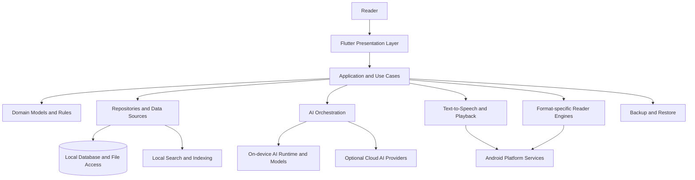

# EmotionalNovelReader

> **Read Beyond Words. Understand Every Emotion.**  
> An offline-first AI reading companion where stories, emotions, and intelligence come together.

[](https://flutter.dev/)
[](https://dart.dev/)
[](https://developer.android.com/)
[](#license)
[](#continuous-integration-and-delivery)
[](#testing-and-quality)
[](#versioning-and-releases)

> **Project status:** Product planning and core documentation are complete. The fresh Flutter project and implementation have not yet started. Feature descriptions below represent the product scope, not a claim that those features are already implemented.

---

## Table of Contents

- [Overview](#overview)
- [Vision and Goals](#vision-and-goals)
- [Who Is It For?](#who-is-it-for)
- [Product Principles](#product-principles)
- [Features and Product Scope](#features-and-product-scope)
- [Platform and Compatibility](#platform-and-compatibility)
- [Technology Stack](#technology-stack)
- [Architecture Overview](#architecture-overview)
- [Repository Structure](#repository-structure)
- [Getting Started](#getting-started)
- [Development Workflow](#development-workflow)
- [Testing and Quality](#testing-and-quality)
- [Build and Release](#build-and-release)
- [Security and Privacy](#security-and-privacy)
- [Screenshots and Demonstrations](#screenshots-and-demonstrations)
- [Roadmap](#roadmap)
- [Project Documentation](#project-documentation)
- [Contributing](#contributing)
- [Bug Reports and Feature Requests](#bug-reports-and-feature-requests)
- [Security Vulnerability Reporting](#security-vulnerability-reporting)
- [Versioning and Releases](#versioning-and-releases)
- [License](#license)
- [Acknowledgements](#acknowledgements)

---

## Overview

**EmotionalNovelReader (ENR)** is an offline-first Flutter application designed for people who love novels, light novels, and ebooks and want to understand more than the words on a page.

ENR combines a customizable ebook-reading experience with AI-assisted story understanding. It aims to help readers explore emotions, characters, relationships, themes, and narrative structure while keeping core reading capabilities available without an internet connection.

The application is being designed around local data ownership and user control. Local AI is a first-class direction; optional cloud services may extend selected capabilities, but cloud processing must remain explicit, transparent, and consent-based.

ENR is intended to be both a capable everyday reader and a thoughtful reading companion. It should support the simple act of opening a book just as carefully as more advanced tasks such as exploring a character's emotional development or asking questions about a story without accidentally revealing future plot events.

## Vision and Goals

The goal is to create a reliable, accessible, privacy-conscious reading application that:

- Provides a comfortable and customizable reading experience.
- Supports a broad range of ebook and document formats where technically and legally feasible.
- Makes core reading, library access, and reading progress available offline.
- Uses AI to help readers explore emotional and narrative dimensions of books.
- Offers local AI processing where supported by the device and available models.
- Provides optional cloud AI without silent data transmission or fallback.
- Supports offline text-to-speech and practical background narration.
- Gives readers ownership and control over their books, annotations, preferences, and backups.
- Delivers useful reading insights without turning reading into a competition or notification-driven habit.

## Who Is It For?

ENR is intended for:

- **Everyday readers** who want a comfortable way to organize and read novels and ebooks.
- **AI-curious readers** who want help understanding emotions, characters, relationships, themes, and story development.
- **Privacy-conscious readers** who value local storage, offline access, and control over data shared with external services.
- **Accessibility-focused readers** who benefit from narration, adaptable typography, high contrast, and other reading accommodations.

## Product Principles

These principles guide product and technical decisions.

### Offline-first

- Core reading functionality should work without an internet connection.
- Local access to the library, reading progress, and supported user data should not depend on a remote service.
- Network-dependent features must be isolated and must fail without breaking core reading.
- Synchronization or remote access must not be assumed to be available.

### Privacy-first

- Local processing and storage are preferred where practical.
- Cloud AI and other external processing must be optional and disabled by default where specified by the product requirements.
- Before data is sent externally, users must receive a clear explanation of what will be shared and with whom.
- Credentials and sensitive information must be protected using appropriate platform security facilities.
- Diagnostics remain local by default; optional reporting requires explicit consent.

### AI transparency and responsible interpretation

- AI-generated analysis is an interpretation, not an objective fact.
- The application should communicate uncertainty and distinguish story evidence from interpretation.
- Users should be able to correct or challenge AI-generated insights.
- Story-aware AI features must respect the reader's current position and spoiler preferences.
- Cloud AI must never be used as a silent fallback when local AI is unavailable.

### User control

Readers should retain meaningful control over:

- Reading appearance, navigation, and accessibility preferences.
- AI model and provider selection.
- Whether eligible features use local or cloud processing.
- Data export, backup, restore, and deletion.
- Imported files and storage management.

### Quality and maintainability

- Prefer understandable, testable, maintainable solutions over unnecessary complexity.
- Use evidence-based technical decisions and document significant trade-offs.
- Treat migrations, backup recovery, and data integrity as core product concerns.
- Validate important behavior on real Android devices, not only in a development environment.
- Accessibility, performance, and reliability are product requirements, not last-minute polish.

---

## Features and Product Scope

The following is the intended product scope defined by the product requirements. It is not a list of currently verified, implemented capabilities.

**Feature status convention**

- **Planned:** Included in product scope; implementation has not been verified.
- **Under investigation:** Technical approach, package, engine, or feasibility still needs evaluation.
- **Implemented:** Use only after the feature has been implemented and verified with appropriate evidence.

At the current project stage, the feature groups below are **planned** unless explicitly updated in project tracking.

### 1. Reading and document support

The reader is intended to support a broad selection of formats, subject to technical feasibility, licensing, and rendering quality:

- EPUB
- PDF
- TXT
- DOCX
- HTML
- RTF
- Markdown
- CBZ and CBR
- MOBI, AZW, and AZW3 where feasible and legally supported
- Additional formats where justified

The application should preserve imported original files. It must not bypass DRM or other access controls.

Reader capabilities are expected to include:

- Customizable typography, font size, line spacing, margins, and reading backgrounds.
- Themes and reading modes.
- Reading navigation and position tracking.
- Bookmarks, highlights, and annotations.
- Accessibility-aware rendering and controls.
- A consistent reader experience across format-specific rendering engines.

### 2. AI-powered story understanding

Planned AI capabilities include:

- Emotion and sentiment exploration.
- Chapter and book summaries.
- Character insights and development.
- Character relationship analysis.
- Story and narrative structure exploration.
- Reading recommendations.
- A text-based reading assistant.
- Context-aware answers grounded in book content.

AI output should communicate uncertainty, provide relevant evidence where possible, and distinguish facts stated in the text from model-generated interpretations.

### 3. Local and optional cloud AI

The intended AI architecture includes:

- On-device inference using compatible local models.
- Model discovery, download, import, update, and removal where supported.
- Capability-aware model selection and user override.
- Resource-aware execution considering memory, performance, battery, and thermal limits.
- Optional cloud AI providers behind replaceable integration boundaries.
- Explicit consent and disclosure before content is transmitted to a cloud provider.
- Retrieval-augmented generation (RAG) using appropriate keyword, semantic, metadata, or hybrid retrieval methods.

The inference engine, model formats, providers, and retrieval implementation remain subject to technical investigation.

### 4. Spoiler-aware assistance

The reading assistant is intended to respect the reader's current position in a book.

- Answers should be limited to content the reader has reached by default.
- Explicit user overrides may permit broader story context.
- Retrieval and prompt construction must enforce spoiler boundaries, rather than relying only on model instructions.
- The application should make the active spoiler scope understandable to the reader.

### 5. Text-to-speech and listening

Planned narration capabilities include:

- Native Android text-to-speech integration.
- Offline voices or downloadable speech resources where feasible.
- Optional cloud voices.
- Background narration where Android platform rules permit.
- Lock-screen and media controls where supported.
- Audio focus, interruption, Bluetooth, and playback lifecycle handling.
- Reading-position synchronization with narration where reliable timing information is available.

Word-level synchronization must not be promised for engines that do not provide word timing. Ambient audio, if provided, should be independently controllable from narration.

### 6. Library and book management

The library is intended to provide:

- Import and organization of books.
- Book metadata and details.
- Search and filtering.
- Reading progress and last-read position.
- Storage visibility and management.
- Safe handling of missing, moved, or inaccessible imported files.

### 7. Personalization and accessibility

Planned options include:

- Reader themes and appearance settings.
- Typography and layout customization.
- Dyslexia-friendly font options where available.
- High-contrast presentation.
- TalkBack-compatible controls and semantics.
- Reduced-motion support.
- Large, usable touch targets.
- Focus-oriented reading modes.

### 8. Reading productivity and insights

Planned capabilities include:

- Highlights, bookmarks, and annotations.
- Basic reading goals, such as time, pages, or chapters.
- Reading-time and progress statistics.
- Daily, weekly, monthly, and yearly views.

The product scope does not include competitive achievements, challenges, streak pressure, or reminders for unfinished books and reading goals. Essential operational notices, such as download completion or errors, may be considered where useful.

### 9. Offline storage and synchronization

The application is designed around local persistence.

- Core reading data should remain available offline.
- Local changes should be durable and recoverable.
- Any synchronization must handle failures and conflicts safely.
- Remote services must not become mandatory for core reading.
- Automatic multi-device synchronization is not part of the initial product scope.

### 10. Backup, restore, and data ownership

Planned data-management capabilities include:

- Complete local backup.
- Manual export and import.
- Selective restore where supported.
- Backup integrity checks and recovery safeguards.
- Optional user-initiated cloud backup destinations, subject to explicit user action and consent.
- Clear warnings when exported backup files are unencrypted and can be read by anyone who obtains them.
- Safe storage cleanup that does not silently delete important user data.

---

## Platform and Compatibility

### Initial platform

| Platform | Scope |
|---|---|
| Android | Initial development and production target |
| iOS | Possible future platform; not part of the initial release commitment |
| Windows, macOS, Linux | Not currently in scope |
| Flutter Web | Development or testing use only where useful; not a substitute for Android-native validation |

The initial Android target is **Android 12 (API level 31) or later**, as specified by the current product requirements. Final `minSdk`, `targetSdk`, compile SDK, and supported device requirements must be confirmed during project setup and release preparation.

The application must be tested on real Android hardware for platform-specific behavior such as document access, background audio, notifications, storage, and lifecycle handling.

---

## Technology Stack

### Confirmed project direction

| Area | Direction | Status |
|---|---|---|
| Application framework | Flutter | Selected |
| Primary language | Dart | Selected |
| Initial platform | Android | Selected |
| Android integration | Android SDK and native capabilities as required | Required |
| Backend dependency | No mandatory legacy Node.js/Express backend | Product constraint |
| Core data model | Local-first | Product constraint |

### Technologies under investigation

The following are evaluation areas, not final package selections.

| Area | Candidates / investigation scope |
|---|---|
| Application architecture | Feature-first, layered architecture, Clean Architecture, modular approaches |
| State management | Riverpod, BLoC/Cubit, Provider, and alternatives |
| Dependency injection | Compile-time and runtime DI options suitable for Flutter |
| Local persistence | SQLite/Drift, Isar, ObjectBox, Hive, and alternatives |
| Full-text search | SQLite FTS5, dedicated local search, application-level indexing |
| EPUB and document rendering | Format-specific Flutter/native rendering engines |
| PDF rendering | Maintained PDF rendering and annotation options |
| Local AI inference | llama.cpp/GGUF, ONNX Runtime, MediaPipe, LiteRT, native Android inference, and alternatives |
| AI retrieval | Keyword, semantic, metadata-filtered, and hybrid RAG |
| Cloud AI | Provider adapters behind a common application interface |
| Text-to-speech | Native Android TTS, offline voice resources, optional cloud TTS |
| Background work | WorkManager, eligible foreground services, isolates, and ordinary asynchronous work |
| Navigation | Declarative routing and platform-appropriate navigation |
| Secure credentials | Secure storage backed by Android Keystore where appropriate |
| Networking | Shared networking foundation with isolated provider adapters |
| Diagnostics | Local-first diagnostics and optional consent-based crash reporting |
| CI/CD | Automated verification and builds with protected signing and release approval |

Package and engine choices should be made only after evaluating compatibility, maintenance, security, licensing, performance, app size, Android support, and long-term viability. The selected options and rationale should be recorded in `DECISIONS.md` and the relevant technical documentation.

---

## Architecture Overview

The final architecture is not yet approved. The following diagram is a **conceptual target**, not a claim about the current source tree.



### Intended architectural responsibilities

| Area | Responsibility |
|---|---|
| Presentation | Screens, reader UI, navigation, accessibility, and user interaction |
| Application | Use cases and coordination of product workflows |
| Domain | Core models, business rules, and product invariants |
| Data | Repositories, persistence, import metadata, and external data adapters |
| Local storage | Durable user data, book metadata, progress, annotations, and other local records |
| Reader engines | Format-specific parsing, layout, rendering, and supported interaction |
| AI orchestration | Context preparation, spoiler enforcement, model/provider selection, and response handling |
| Local AI runtime | On-device model execution and lifecycle/resource management |
| Cloud adapters | Explicitly authorized remote AI or other external integrations |
| TTS and playback | Narration, playback lifecycle, and Android media integration |
| Backup and restore | Export, validation, restore, and recovery safeguards |

### Key boundaries

- Core reading must not depend on AI availability.
- Local AI and cloud AI must be replaceable behind application-owned interfaces.
- Format-specific rendering engines should integrate through a consistent reader-facing abstraction where practical.
- Imported source files should remain distinct from derived data such as indexes or cached content.
- Spoiler enforcement must be applied in the application-controlled retrieval/context pipeline.
- Platform-specific code should be isolated behind clear interfaces.
- Data migrations and backup compatibility must be treated as explicit design concerns.

The final architecture, module boundaries, data flow, and package selections will be updated after the technical investigations described in `trd.md`.

---

## Repository Structure

The fresh Flutter project should be generated using the Flutter tooling. Its exact structure will be confirmed after architecture investigation.

### Expected Flutter project baseline

```text
EmotionalNovelReader/
├── android/                 # Android application and native integration
├── lib/                     # Flutter application source
├── test/                    # Unit and widget tests
├── integration_test/        # Integration tests
├── assets/                  # App-owned static assets, if required
├── docs/                    # Supporting technical documentation
├── AGENT.md                 # Agent and development governance
├── README.md                # Project overview and developer guide
├── prd.md                   # Product Requirements Document
├── trd.md                   # Technical Requirements Document
├── ROADMAP.md               # Phases, milestones, and dependencies
├── TASKS.md                 # Actionable work tracking
├── DECISIONS.md             # Architecture and technology decisions
├── CHANGELOG.md             # User-visible and significant project changes
└── pubspec.yaml             # Flutter dependencies and project metadata
```

### Potential source organization

The following is illustrative. It must not be treated as an approved architecture until the investigation is complete.

```text
lib/
├── app/                     # App bootstrap, root composition, configuration
├── core/                    # Shared foundations and cross-cutting concerns
│   ├── errors/
│   ├── logging/
│   ├── platform/
│   ├── storage/
│   └── utilities/
├── features/
│   ├── library/
│   ├── reader/
│   ├── import/
│   ├── annotations/
│   ├── search/
│   ├── ai_assistant/
│   ├── emotion_analysis/
│   ├── text_to_speech/
│   ├── statistics/
│   ├── backup/
│   └── settings/
└── main.dart
```

Directory names, feature boundaries, and layering will be revised to match the selected architecture. Do not create empty folders solely to match this illustrative tree.

---

## Getting Started

> **Setup status:** The fresh Flutter project has not yet been created. Commands below are the intended setup workflow. Repository URLs, exact SDK versions, and project-specific scripts must be filled in after the repository and environment are established.

### Prerequisites

Install and configure:

1. Git.
2. Flutter SDK, including the compatible Dart SDK bundled with Flutter.
3. Android Studio or another supported Android development environment.
4. Android SDK and required SDK platform/build tools.
5. A compatible JDK for the selected Android Gradle Plugin and Gradle versions.
6. Android Emulator or a physical Android device.
7. Required device drivers and platform tools for physical-device debugging, where applicable.

Use the official installation guides:

- [Flutter installation](https://docs.flutter.dev/get-started/install)
- [Flutter Android setup](https://docs.flutter.dev/platform-integration/android/setup)
- [Android Studio](https://developer.android.com/studio)
- [Android SDK](https://developer.android.com/tools)

### Verify the development environment

```bash
flutter --version
dart --version
flutter doctor -v
git --version
```

Resolve relevant Flutter and Android toolchain issues reported by `flutter doctor` before attempting a device build.

Check available devices:

```bash
flutter devices
```

### Clone the repository

The canonical repository URL has not yet been recorded. Replace the placeholder after the repository is established.

```bash
git clone <REPOSITORY_URL>
cd EmotionalNovelReader
```

### Install dependencies

After the Flutter project and `pubspec.yaml` have been created:

```bash
flutter pub get
```

### Run the application

Start an Android emulator or connect an Android device with USB debugging enabled.

```bash
flutter devices
flutter run
```

If multiple devices are connected, select the intended device explicitly:

```bash
flutter run -d <DEVICE_ID>
```

### Common environment checks

```bash
flutter doctor -v
flutter pub get
flutter analyze
flutter test
```

These commands are baseline examples. Project-specific scripts and additional validation commands will be documented as the build and CI workflows are established.

---

## Development Workflow

### Before making changes

1. Read `AGENT.md` and the relevant product and technical requirements.
2. Check the current branch and working tree.
3. Read relevant entries in `TASKS.md`, `ROADMAP.md`, and `DECISIONS.md`.
4. Inspect the affected code, dependencies, and tests before implementation.
5. Identify scope, acceptance criteria, risks, and required verification.

### During implementation

- Keep changes focused and consistent with the approved architecture.
- Prefer small, reviewable changes.
- Add or update tests for behavior changes.
- Handle offline, error, cancellation, and recovery paths where relevant.
- Avoid exposing secrets or sending user content to external services without the required consent.
- Update technical documentation when architecture, data contracts, dependencies, or workflows change.
- Preserve user changes and avoid destructive Git operations.

### Before considering work complete

Run the relevant formatting, analysis, tests, and build checks. Review the final diff and confirm that documentation and project tracking are updated.

A completion report should summarize:

- What changed and why.
- Root cause for bug fixes.
- Important files and architectural effects.
- Dependencies added, removed, or changed.
- Tests, analysis, builds, and device checks performed.
- Documentation and Git changes.
- Remaining risks, limitations, and blockers.

See `AGENT.md` for the authoritative project execution and governance rules.

---

## Testing and Quality

Testing is expected to be layered and Android-aware.

### Planned verification layers

| Test type | Intended coverage |
|---|---|
| Unit tests | Domain rules, calculations, use cases, data transformations, and services |
| Widget tests | UI states, interactions, accessibility semantics, and presentation behavior |
| Integration tests | Multi-component workflows, persistence, imports, and reader interactions |
| Android device tests | Platform APIs, lifecycle, storage access, audio, background work, and device behavior |
| Regression tests | Previously fixed defects and important product invariants |
| Performance tests | Startup, scrolling, rendering, indexing, AI execution, memory, and battery impact |
| Accessibility checks | TalkBack, contrast, text scaling, focus, and reduced motion |
| Security checks | Import validation, local data protection, credential handling, and network boundaries |
| Recovery tests | Interrupted operations, corrupted or incomplete backups, migration failures, and process termination |

### Baseline local commands

```bash
dart format --output=none --set-exit-if-changed .
flutter analyze
flutter test
```

Run integration tests on an appropriate Android target:

```bash
flutter test integration_test
```

The exact test commands, supported environments, coverage expectations, and release gates will be refined in the testing strategy.

**A passing static analysis result alone does not establish release readiness.** Critical workflows must also be verified with appropriate tests and real Android device checks.

---

## Build and Release

### Debug build

```bash
flutter build apk --debug
```

### Release APK

```bash
flutter build apk --release
```

### Release Android App Bundle

```bash
flutter build appbundle --release
```

The output paths are normally under:

```text
build/app/outputs/flutter-apk/
build/app/outputs/bundle/release/
```

Confirm the actual output files and build configuration before distributing an artifact.

### Signing and secrets

Release signing must be configured securely.

- Do not commit keystores, signing passwords, API keys, or private credentials.
- Use protected CI secrets or an approved secure local configuration.
- Restrict access to release-signing material.
- Verify application ID, version, signing identity, permissions, and build variant before distribution.
- Keep development and production configuration separated where applicable.

### Continuous Integration and Delivery

CI/CD workflows are planned but not yet configured. The intended pipeline should progressively automate:

1. Dependency resolution and environment validation.
2. Formatting checks and static analysis.
3. Unit and widget tests.
4. Relevant integration tests.
5. Android debug/release build verification.
6. Dependency and security checks.
7. Artifact retention and release metadata.

Production publication must retain an explicit human approval gate. Signing credentials must be protected, and release artifacts should be traceable to their source revision.

---

## Security and Privacy

Security and privacy requirements are part of the product design.

- Keep core reading usable without an account or mandatory backend.
- Validate imported files and handle malformed or unexpectedly large inputs safely.
- Protect credentials using appropriate secure platform storage.
- Avoid logging book contents, personal data, credentials, or other sensitive information.
- Do not transmit book content to cloud AI without the required user consent and disclosure.
- Keep local and cloud AI paths explicit and independently controllable.
- Do not silently fall back from local AI to cloud AI.
- Provide understandable export, deletion, backup, and restore behavior.
- Treat backup files according to their actual encryption status and explain risks to users.
- Use least-privilege Android permissions and justify each permission.
- Keep dependencies maintained and evaluate their security posture and licenses.

A formal threat model and detailed security procedures will be maintained in the planned `SECURITY.md` documentation.

---

## Screenshots and Demonstrations

Application screenshots and recordings will be added after the corresponding UI exists and has been verified.

### Planned preview gallery

| Preview | Planned asset |
|---|---|
| Library | `docs/images/library.png` |
| Reader | `docs/images/reader.png` |
| AI reading assistant | `docs/images/ai-assistant.png` |
| Emotion analysis | `docs/images/emotion-analysis.png` |
| Text-to-speech | `docs/images/text-to-speech.png` |
| Settings and personalization | `docs/images/settings.png` |

### Demonstrations

Short GIF or video demonstrations may be added for workflows such as:

- Importing and opening a book.
- Navigating chapters and saving reading progress.
- Creating highlights and annotations.
- Using spoiler-aware AI assistance.
- Starting and controlling narration.
- Exporting and restoring a backup.

These paths are placeholders only. No preview assets are claimed to exist yet.

---

## Roadmap

The roadmap is intentionally phase-oriented. Detailed tasks, dependencies, acceptance criteria, and status belong in `ROADMAP.md` and `TASKS.md`.

| Phase | Focus | Status |
|---|---|---|
| 1 | Product definition and documentation baseline | Completed |
| 2 | Fresh Flutter project and development environment setup | Planned |
| 3 | Technical architecture and technology investigations | Planned |
| 4 | Core application foundation, local persistence, and library | Planned |
| 5 | Reader, document import, rendering, and reading experience | Planned |
| 6 | Annotations, search, statistics, and offline workflows | Planned |
| 7 | Text-to-speech and Android media integration | Planned |
| 8 | Local AI, retrieval, spoiler protection, and optional cloud AI | Planned |
| 9 | Backup, restore, security, accessibility, and hardening | Planned |
| 10 | Android beta, release verification, and distribution | Planned |

The order and boundaries may change when dependencies and technical feasibility are established. Core reading reliability takes priority over advanced AI capabilities.

---

## Project Documentation

The following documents provide the detailed requirements and project governance. Links are relative to the repository root.

### Available documentation

| Document | Purpose |
|---|---|
| [`AGENT.md`](AGENT.md) | Agent instructions, autonomy boundaries, Git safety, verification, and reporting |
| [`prd.md`](prd.md) | Product vision, user needs, functional requirements, and product constraints |
| [`trd.md`](trd.md) | Technical requirements, investigation areas, candidate technologies, and unresolved decisions |

### Project management documentation

These files are part of the intended project documentation set. Create them in the repository when the project tracking baseline is established.

| Document | Purpose |
|---|---|
| [`ROADMAP.md`](ROADMAP.md) | Phases, milestones, dependencies, and release goals |
| [`TASKS.md`](TASKS.md) | Actionable tasks, priorities, status, and blockers |
| [`DECISIONS.md`](DECISIONS.md) | Architecture decision records and technology choices |
| [`CHANGELOG.md`](CHANGELOG.md) | Significant changes and release history |

### Planned technical documentation

Create these when the relevant technical decisions and implementation details are established.

| Document | Purpose |
|---|---|
| `docs/ARCHITECTURE.md` | Approved architecture, modules, boundaries, and data flow |
| `docs/SECURITY.md` | Threat model, security controls, and vulnerability handling |
| `docs/DATABASE.md` | Persistence model, schemas, indexes, and migrations |
| `docs/TESTING.md` | Test strategy, environments, and quality gates |
| `docs/AI_ARCHITECTURE.md` | Local/cloud inference, model lifecycle, RAG, and spoiler enforcement |
| `docs/READER_ENGINES.md` | Format support and rendering-engine decisions |
| `docs/BACKUP_RESTORE.md` | Backup formats, integrity, restore, and recovery |
| `docs/RELEASE.md` | Android signing, CI/CD, release process, and distribution |

The documentation index should be updated whenever documents are added, renamed, or retired.

---

## Contributing

Contribution guidelines will be finalized when the repository hosting and review workflow are established.

Until then, proposed contributions should follow these principles:

1. Review `AGENT.md`, `prd.md`, and `trd.md` before making substantial changes.
2. Check existing tasks and decisions before starting work.
3. Keep changes focused and explain their purpose.
4. Add tests for new behavior and regressions.
5. Run formatting, analysis, and relevant tests.
6. Update documentation and project tracking alongside implementation.
7. Do not include secrets, personal data, or copyrighted book content in commits or test fixtures without authorization.
8. Preserve existing user work and follow the Git safety requirements in `AGENT.md`.

### Suggested Git workflow

The exact branch names and protected-branch configuration are repository-specific and will be documented after repository setup.

The intended workflow is:

- Work on a focused feature or fix branch.
- Keep commits small and descriptive.
- Use pull requests for review where repository hosting supports them.
- Require relevant automated checks before merging.
- Preserve checkpoints and avoid rewriting shared history.
- Do not force-push or perform destructive Git operations without the required approval.

### Commit message convention

A conventional-commit-style format is recommended, subject to confirmation in the repository workflow:

```text
<type>(<scope>): <short description>
```

Examples:

```text
feat(reader): add chapter navigation
fix(import): handle inaccessible document URI
test(library): cover offline loading state
docs(architecture): record storage decision
```

---

## Bug Reports and Feature Requests

Use the project's issue tracker once the canonical repository is available.

- **Bug reports:** Include reproducible steps, expected behavior, actual behavior, device/Android version, app version or commit, and relevant sanitized logs.
- **Feature requests:** Explain the user problem, expected outcome, offline/privacy implications, and acceptance criteria.
- **Questions:** Check the project documentation and FAQ first.

Repository issue URL: **To be configured.**

Do not attach private book files, personal data, credentials, or unredacted diagnostic logs to public issues.

---

## Security Vulnerability Reporting

Please do not publish exploitable security details, credentials, private user data, or proof-of-concept material for an unpatched vulnerability in a public issue.

A private security reporting channel and responsible-disclosure process must be configured before public distribution.

Security contact: **To be configured.**

Until that channel exists, avoid posting sensitive vulnerability details publicly.

---

## Versioning and Releases

The project intends to use **Semantic Versioning** once versioned releases begin:

```text
MAJOR.MINOR.PATCH
```

- **MAJOR:** Incompatible changes to public behavior or supported data formats.
- **MINOR:** Backward-compatible product functionality.
- **PATCH:** Backward-compatible fixes and maintenance changes.

Release stages will be distinguished clearly:

- **Development builds:** Unreleased builds used during active development.
- **Beta releases:** Pre-release builds used for broader validation and feedback.
- **Stable releases:** Verified releases approved for general distribution.

The initial application version, release cadence, distribution channel, and release checklist are still to be established. Release notes and significant changes should be recorded in `CHANGELOG.md`.

---

## License

**License: Not yet decided.**

No open-source or proprietary license is implied by this README. A license decision and corresponding `LICENSE` file must be made before distribution or acceptance of external contributions.

---

## Acknowledgements

EmotionalNovelReader is being developed with Flutter and the wider open-source ecosystem. Third-party libraries, models, fonts, and other assets will be acknowledged with their applicable licenses and attribution requirements as they are selected.

---

## Project Status Summary

| Area | Current status |
|---|---|
| Product discovery | Completed |
| Product Requirements Document | Prepared |
| Technical Requirements Document | Prepared |
| Agent and project governance | Prepared |
| Fresh Flutter project | Not started |
| Architecture and package selection | Pending investigation |
| Core implementation | Not started |
| Automated CI/CD | Not configured |
| Public release | Not available |

**The immediate next milestone is to establish the fresh Flutter project safely, verify the development environment, and complete evidence-based technical investigations before committing to the final architecture and dependencies.**
