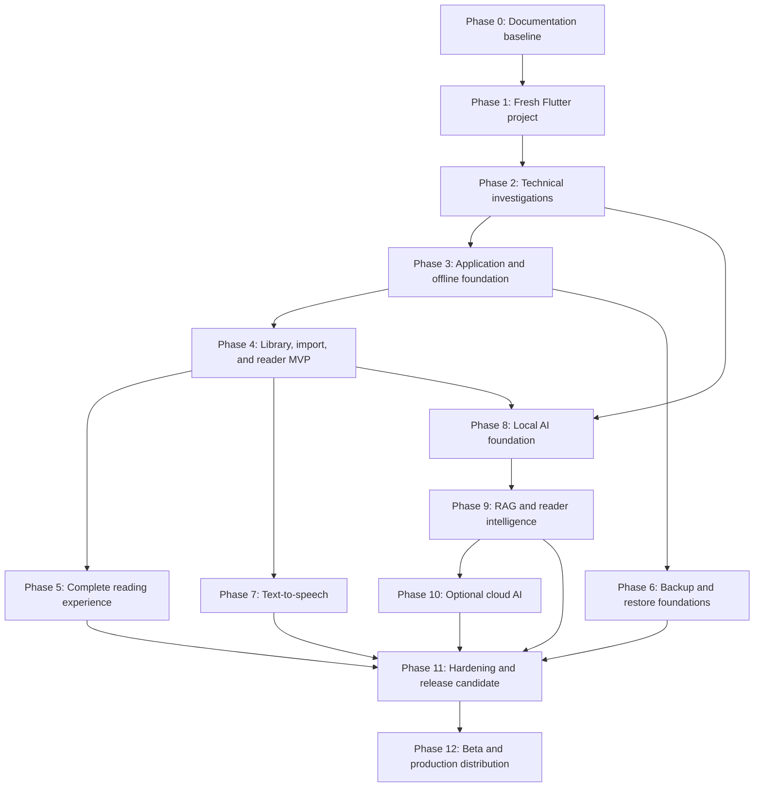

# EmotionalNovelReader Task Tracker

> **Project:** EmotionalNovelReader (ENR)  
> **Purpose:** Central actionable backlog for project setup, investigation, implementation, verification, and release.  
> **Initial status:** Baseline backlog prepared; no new Flutter implementation is claimed as started.  
> **Last updated:** 8 November 2026

---

## 1. Purpose and How to Use This File

`TASKS.md` is the central execution tracker for EmotionalNovelReader.

It translates the milestones in `ROADMAP.md` into actionable work that a primary developer or AI coding agent can investigate, implement, test, review, and report.

Use the documents for distinct purposes:

| Document | Responsibility |
|---|---|
| `AGENT.md` | Authoritative agent instructions, autonomy boundaries, Git safety, verification, and reporting |
| `README.md` | Product overview and developer entry point |
| `prd.md` | Product requirements and user-facing scope |
| `trd.md` | Technical requirements and investigation scope |
| `ROADMAP.md` | Development phases, milestones, dependencies, and release outcomes |
| `TASKS.md` | Actionable work, priorities, ownership, status, blockers, and evidence |
| `DECISIONS.md` | Accepted decisions, alternatives, rationale, and unresolved decisions |
| `CHANGELOG.md` | Significant changes and release history |

### 1.1 Backlog principles

- This file includes the full planned lifecycle, from fresh project setup to production release.
- Initial setup and investigation tasks are prioritized for execution.
- Future implementation tasks are planning placeholders until their prerequisites and technical decisions are sufficiently clear.
- Do not treat a candidate package or architecture in `trd.md` as selected until a decision is recorded.
- Do not mark a feature implemented merely because a task was drafted.
- Keep individual tasks small enough to investigate, implement, verify, and report.
- Use task IDs as stable references. Do not renumber IDs when tasks move between phases or modules.
- Add newly discovered work after checking for duplicates and dependencies.
- Keep task detail here; keep milestone-level summaries in `ROADMAP.md`.
- Follow `AGENT.md` for approval boundaries and safe execution.

---

## 2. Task Status Model

Use one of the following statuses.

| Status | Meaning |
|---|---|
| Planned | Accepted into the backlog; work has not started. |
| Investigating | Scope, feasibility, root cause, or technical options are being examined. |
| Blocked | Work cannot proceed until a dependency or blocker is resolved. |
| Ready | Scope, owner, dependencies, and acceptance criteria are clear enough to start. |
| In Progress | Work is actively being performed. |
| In Review | Work is implemented and awaiting review. |
| Testing | Verification is underway. |
| Completed | Acceptance criteria and verification requirements are met; evidence is recorded. |
| Deferred | Intentionally postponed with a reason and revisit condition. |
| Cancelled | Removed from scope with rationale recorded. |

**Initial status convention:** Unless explicitly marked otherwise, tasks in this initial baseline are `Planned`. Tasks in the immediate setup queue may be changed to `Ready` only after the repository, directory, and environment have been verified.

---

## 3. Priority and Product Necessity

### 3.1 Execution priority

| Priority | Label | Meaning |
|---|---|---|
| P0 | Critical | Blocks project setup, data integrity, core reading, security, or release progression. |
| P1 | High | Required for the MVP or a major product capability. |
| P2 | Medium | Important capability that can follow the core MVP. |
| P3 | Low | Optional or later enhancement. |

### 3.2 MoSCoW classification

MoSCoW is tracked separately from execution priority.

- **Must Have:** Required for the agreed release or product requirement.
- **Should Have:** Important, but can be deferred without invalidating the release.
- **Could Have:** Useful enhancement if capacity and dependencies permit.
- **Won't Have (this release):** Explicitly excluded from the current release scope.

A task's priority and MoSCoW value need not map one-to-one. For example, a high-priority technical investigation may support a later optional capability.

### 3.3 Readable priority labels

| Priority | Readable label |
|---|---|
| P0 | Critical |
| P1 | High |
| P2 | Medium |
| P3 | Low |

---

## 4. Task Hierarchy and Identification

Tasks use a three-level hierarchy:

1. **Epic:** A major capability, phase, or outcome.
2. **Task:** A deliverable or coherent unit of work.
3. **Subtask:** A small executable activity that can be assigned and verified independently.

### 4.1 Stable canonical IDs

Canonical IDs use this format:

```text
ENR-0001
ENR-0002
ENR-0003
```

IDs are sequential and stable. Phase, epic, and module are separate metadata fields, so moving a task does not change its identity.

### 4.2 Additional classification

| Field | Example |
|---|---|
| Phase | `P01` |
| Epic | `E01` |
| Module | `READER`, `AI`, `DATABASE`, `IMPORT`, `TTS`, `BACKUP` |
| Parent | `ENR-0010` |
| Subtask | `ENR-0011` |
| Related task | `ENR-0020` |

### 4.3 Task size and effort

Use all three estimation approaches when useful:

- **Size:** XS, S, M, L, XL.
- **Time:** Optional estimated hours.
- **Story points:** Optional relative effort for grouped work.

Estimates are provisional. Use `TBD` when scope is not sufficiently understood. Do not invent precision before investigation.

---

## 5. Ownership and Accountability

Allowed owner values:

- **Primary Developer:** Accountable for project coordination, decisions, and approval.
- **AI Agent:** Assigned investigation, implementation, testing, review, or documentation work.
- **Delegated Agent:** A scoped independent workstream.
- **Shared:** Coordinated work with explicit individual responsibilities.
- **Unassigned:** Not yet allocated.

Every active task must have an accountable owner. `Unassigned` is acceptable for planned work, but not for active work without an explicit reason.

AI agents may create necessary follow-up tasks within approved scope. Material product-scope expansion, irreversible destructive operations, external publication, and other approval-gated actions follow `AGENT.md`.

---

## 6. Dependencies and Relationships

Use these relationship types:

- **Depends on:** Work that must be completed before this task can start or be accepted.
- **Blocks:** Work that cannot proceed until this task is complete.
- **Related to:** Work with a meaningful connection but no strict ordering requirement.

Example:

```text
ENR-0020
  Depends on: ENR-0012, ENR-0015
  Blocks: ENR-0031
  Related to: ENR-0040
```

### 6.1 Dependency graph rules

- Record dependencies using canonical task IDs.
- Review dependency changes when tasks are moved or split.
- Identify circular dependencies before execution.
- Identify tasks that can safely run in parallel.
- Do not create artificial dependencies merely because tasks are in the same phase.
- A task may be blocked by an external decision or resource; record that explicitly.

### 6.2 Initial critical-path outline



This is a high-level dependency view. Individual task dependencies below are authoritative when more specific.

---

## 7. Task Execution Contract

Every executable task should include:

- **Context:** Why the task exists and which requirements it supports.
- **Scope:** What is included and excluded.
- **Investigation:** What must be inspected or validated before implementation.
- **Implementation guidance:** Constraints and relevant architectural decisions, without prematurely dictating an unselected design.
- **Acceptance criteria:** Observable conditions that define success.
- **Verification:** Tests, analysis, builds, device checks, or review required.
- **Documentation:** Files that must be updated.
- **Dependencies:** Required task IDs and external prerequisites.
- **Approval boundary:** Any action requiring explicit approval.
- **Completion evidence:** Links, command results, test names, review findings, or other verifiable proof.

### 7.1 Definition of done

A task can be marked `Completed` only when:

1. Its acceptance criteria are satisfied.
2. Relevant implementation or investigation work is reviewed.
3. Formatting and static analysis pass where applicable.
4. Relevant unit, widget, integration, regression, and device tests pass as applicable.
5. Build verification is completed when relevant.
6. Security, privacy, accessibility, performance, and data-integrity implications are addressed.
7. Documentation and related task records are updated.
8. Blockers and residual risks are recorded.
9. Completion evidence is attached to the task.

An agent's statement that work is complete is not sufficient evidence.

### 7.2 Task execution boundaries

Agents may autonomously investigate, plan, implement, test, review, and document work within an approved task scope, subject to `AGENT.md`.

Do not proceed without required approval for:
- Irreversible data-loss or destructive operations.
- External publication or production release.
- Material product-scope expansion.
- Other actions explicitly restricted by `AGENT.md`.

Preserve user changes and repository history. Do not force-push or rewrite shared history without explicit approval.

---

# 8. Master Backlog

The backlog is grouped by roadmap phase. The task cards below are the initial planning baseline. All tasks begin as `Planned` unless their status is explicitly updated with evidence.

## Phase 0 - Product and Documentation Baseline

**Status: Completed baseline**

### Epic E00 - Product and governance baseline

| ID | Task | Module | Priority | MoSCoW | Status |
|---|---|---|---:|---|---|
| ENR-0001 | Complete product discovery and consolidate product requirements | PRODUCT | P0 | Must Have | Completed |
| ENR-0002 | Prepare Product Requirements Document | PRODUCT | P0 | Must Have | Completed |
| ENR-0003 | Prepare Technical Requirements Document | ARCHITECTURE | P0 | Must Have | Completed |
| ENR-0004 | Define agent governance and approval boundaries | GOVERNANCE | P0 | Must Have | Completed |
| ENR-0005 | Prepare project README | DOCUMENTATION | P1 | Must Have | Completed |
| ENR-0006 | Prepare project roadmap | GOVERNANCE | P1 | Must Have | Completed |
| ENR-0007 | Create initial task tracker | GOVERNANCE | P1 | Must Have | In Progress |

**Phase exit criteria:** Product and technical requirements, execution governance, and project planning baseline are documented. The task tracker is established and maintained.

---

## Phase 1 - Fresh Flutter Project and Development Environment

**Epic E01 - Establish the new project foundation**

### ENR-0010 - Verify repository and workspace

| Field | Value |
|---|---|
| Phase / Epic | P01 / E01 |
| Module | REPOSITORY |
| Priority / MoSCoW | P0 / Must Have |
| Status | Completed |
| Owner | Primary Developer / AI Agent |
| Size / Effort | M / Completed |
| Depends on | ENR-0002, ENR-0003, ENR-0004 |
| Blocks | ENR-0012, ENR-0013 |
| Related to | ENR-0011 |

**Context:** A clean Flutter project is required. Existing documentation and user work must be preserved.

**Subtasks**
- [x] ENR-0010-S01 Confirm the intended repository and target project directory (`C:\Users\vansh\Documents\Projects\EmotionalNovelReader`).
- [x] ENR-0010-S02 Inspect current Git branch, working tree, remotes, and recent history (`feature/flutter`, origin tracking, clean tree).
- [x] ENR-0010-S03 Identify existing documentation and files that must be preserved (`PRD.md`, `TRD.md`, `AGENT.md`, `ROADMAP.md`, `DECISIONS.md`, `CHANGELOG.md`, `README.md`, `.idea`, `.agents`).
- [x] ENR-0010-S04 Confirm the legacy React Native and backend source are not being reused as the new implementation foundation (purged in commit `27fadf9`).
- [x] ENR-0010-S05 Record any repository or directory risks before project creation (documented in Stage A report).

**Acceptance criteria**
- Target repository and directory are explicitly confirmed.
- Existing changes and required documentation are identified and preserved.
- Git state is understood before any project-generation or cleanup action.
- No destructive operation is performed without required approval.

**Verification**
- Verified clean working tree on `feature/flutter`. All documentation preserved. Report archived in `artifacts/PROJECT_INITIALIZATION_INVESTIGATION.md`.

### ENR-0011 - Verify development environment

| Field | Value |
|---|---|
| Phase / Epic | P01 / E01 |
| Module | TOOLING |
| Priority / MoSCoW | P0 / Must Have |
| Status | Completed |
| Owner | Primary Developer / AI Agent |
| Size / Effort | S / Completed |
| Depends on | ENR-0010 |
| Blocks | ENR-0012 |
| Related to | ENR-0013 |

**Subtasks**
- [x] ENR-0011-S01 Verify Flutter and Dart versions (Flutter 3.47.9 stable, Dart 3.13.7).
- [x] ENR-0011-S02 Run and inspect `flutter doctor -v` (Android toolchain healthy, licenses accepted).
- [x] ENR-0011-S03 Verify Android Studio and Android SDK installation (SDK 36.0.0, build-tools 36.0.0).
- [x] ENR-0011-S04 Verify the compatible JDK and Android Gradle toolchain (Android Studio JBR OpenJDK 25.0.4 + OpenJDK 17).
- [x] ENR-0011-S05 Verify emulator availability (`Medium_Phone_API_37.0` configured).
- [x] ENR-0011-S06 Verify physical Android device availability and debugging access (ADB 1.0.41 v37.0.1 operational).
- [x] ENR-0011-S07 Record environment prerequisites and any blockers (0 blockers for project initialization).

**Acceptance criteria**
- Required tools and versions are recorded.
- Relevant toolchain checks pass or blockers are documented with resolution steps.
- At least one intended Android verification target is available or explicitly identified as unavailable.

**Verification**
- `flutter doctor -v` and `adb version` verified and documented in Stage A report.

### ENR-0012 - Create fresh Flutter project

| Field | Value |
|---|---|
| Phase / Epic | P01 / E01 |
| Module | PROJECT-BOOTSTRAP |
| Priority / MoSCoW | P0 / Must Have |
| Status | Completed |
| Owner | Primary Developer / AI Agent |
| Size / Effort | M / Completed |
| Depends on | ENR-0010, ENR-0011 |
| Blocks | ENR-0014, ENR-0015 |
| Related to | ENR-0013 |

**Subtasks**
- [x] ENR-0012-S01 Confirm application identifier and naming requirements (`com.emotionalnovelreader.app`, "Emotional Novel Reader", ENR-DEC-057).
- [x] ENR-0012-S02 Generate the new Flutter project using the verified Flutter tooling (`flutter create --org com.emotionalnovelreader --project-name emotional_novel_reader --platforms android .`).
- [x] ENR-0012-S03 Place project documentation in the correct repository locations without overwriting existing work (100% existing documentation preserved).
- [x] ENR-0012-S04 Verify generated Android project configuration (`minSdk = 31` enforced, AGP 9.1.0, Kotlin 2.4.0, Gradle 9.3.1).
- [x] ENR-0012-S05 Run the generated application on an Android target (Verified via successful debug APK compilation `build/app/outputs/flutter-apk/app-debug.apk`).
- [x] ENR-0012-S06 Record Flutter and generated project versions (Flutter 3.47.9, Dart 3.13.7, AGP 9.1.0, Gradle 9.3.1, NDK 28.2).

**Acceptance criteria**
- A clean Flutter project exists at the verified target path.
- Generated project files are intact.
- The app compiles and builds successfully for an Android target.
- No legacy application source has been copied into the new project without an approved decision.

**Verification**
- Debug APK compiled successfully: `build/app/outputs/flutter-apk/app-debug.apk` (155 MB).

### ENR-0013 - Establish Git workflow

| Field | Value |
|---|---|
| Phase / Epic | P01 / E01 |
| Module | REPOSITORY |
| Priority / MoSCoW | P0 / Must Have |
| Status | Completed |
| Owner | Primary Developer / AI Agent |
| Size / Effort | M / Completed |
| Depends on | ENR-0010, ENR-0012 |
| Blocks | ENR-0015 |
| Related to | ENR-0014 |

**Subtasks**
- [x] ENR-0013-S01 Define branch naming conventions (Feature branch `feature/flutter` verified and active).
- [x] ENR-0013-S02 Define commit message conventions (Conventional Commits enforced; baseline commit created).
- [x] ENR-0013-S03 Define checkpoint and backup practices (Root `.gitignore` established and verified; machine-specific caches/libraries untracked).
- [x] ENR-0013-S04 Configure branch protection and review checks where supported (Explicit user approval gates and read-only pre-commit audits enforced).
- [x] ENR-0013-S05 Define safe merge, conflict resolution, and rollback workflow (Fast-forwardable history maintained; no blind staging or destructive operations).
- [x] ENR-0013-S06 Document AI-agent parallel-work boundaries (Established in `AGENT.md` and `DECISIONS.md`; high autonomy with risk-gated approvals).

**Acceptance criteria**
- Git workflow is documented.
- User changes and shared history are protected.
- Required review and verification expectations are clear.
- Repository-specific branch names and policies are verified rather than guessed.

**Verification**
- Initial Flutter foundation commit successfully created (`1ee64c1`) with message `feat: initialize Flutter project with Android 12+ baseline`.
- Working tree clean, `.idea/caches/` and `.idea/libraries/` untracked and ignored while preserving local files.

### ENR-0014 - Establish baseline quality tooling

| Field | Value |
|---|---|
| Phase / Epic | P01 / E01 |
| Module | TOOLING |
| Priority / MoSCoW | P0 / Must Have |
| Status | Completed |
| Owner | AI Agent / Primary Developer |
| Size / Effort | M / Completed |
| Depends on | ENR-0012 |
| Blocks | ENR-0015, ENR-0030 |
| Related to | ENR-0013 |

**Subtasks**
- [x] ENR-0014-S01 Verify formatter behavior (`dart format` compatible).
- [x] ENR-0014-S02 Configure or verify static analysis and lint rules (`analysis_options.yaml` configured with strict casts, inference, raw types, and flutter_lints).
- [x] ENR-0014-S03 Verify baseline test execution (`flutter test` passes 100%).
- [x] ENR-0014-S04 Verify debug build commands (`flutter build apk --debug` succeeds).
- [x] ENR-0014-S05 Record baseline checks and expected commands.

**Acceptance criteria**
- Formatting, analysis, tests, and debug build can be executed.
- Baseline failures are resolved or documented.
- Tool configuration is committed and documented where appropriate.

**Verification**
- `flutter analyze`: 0 issues found.
- `flutter test`: 1/1 tests passed.
- `flutter build apk --debug`: Succeeded (`app-debug.apk` generated).

### ENR-0015 - Establish project tracking files

| Field | Value |
|---|---|
| Phase / Epic | P01 / E01 |
| Module | GOVERNANCE |
| Priority / MoSCoW | P1 / Must Have |
| Status | Completed |
| Owner | Primary Developer / AI Agent |
| Size / Effort | S / Completed |
| Depends on | ENR-0012, ENR-0013, ENR-0014 |
| Blocks | ENR-0020 |
| Related to | ENR-0006, ENR-0007 |

**Subtasks**
- [x] ENR-0015-S01 Reconcile and synchronize `TASKS.md`.
- [x] ENR-0015-S02 Verify `DECISIONS.md` with accepted constraints (ENR-DEC-001..024) and unresolved decisions (ENR-DEC-025..056).
- [x] ENR-0015-S03 Update `CHANGELOG.md` with the verified project initialization entries under `[Unreleased]`.
- [x] ENR-0015-S04 Ensure README and roadmap links match actual repository files.
- [x] ENR-0015-S05 Establish a last-updated convention.

**Acceptance criteria**
- Project tracking files exist and are cross-linked.
- No planned document is represented as an existing file until it exists.
- Initial statuses and decisions are accurate.

**Verification**
- `TASKS.md`, `CHANGELOG.md`, `DECISIONS.md`, and `README.md` cross-checked and synchronized with empirical evidence.

---

## Phase 2 - Technical Investigations and Architecture Decisions

**Epic E02 - Resolve high-impact technical decisions**

These tasks are investigations first. A task may produce a prototype, comparison, or recommendation; it must not silently select a technology without recording the decision.

### ENR-0020 - Evaluate application architecture

| Field | Value |
|---|---|
| Phase / Epic | P02 / E02 |
| Module | ARCHITECTURE |
| Priority / MoSCoW | P0 / Must Have |
| Status | Planned |
| Owner | Primary Developer / AI Agent |
| Size / Effort | L / TBD |
| Depends on | ENR-0015 |
| Blocks | ENR-0030, ENR-0031 |
| Related to | ENR-0021, ENR-0022 |

**Subtasks**
- [ ] ENR-0020-S01 Compare feature-first, layered, Clean Architecture, and modular approaches.
- [ ] ENR-0020-S02 Evaluate maintainability, testability, offline workflows, and complexity.
- [ ] ENR-0020-S03 Propose module and dependency boundaries.
- [ ] ENR-0020-S04 Record recommendation, trade-offs, and decision.

**Acceptance criteria**
- Alternatives and evidence are documented.
- Proposed architecture supports the product requirements without unnecessary complexity.
- Decision is recorded in `DECISIONS.md`.

### ENR-0021 - Evaluate state management and dependency injection

| Field | Value |
|---|---|
| Phase / Epic | P02 / E02 |
| Module | ARCHITECTURE |
| Priority / MoSCoW | P0 / Must Have |
| Status | Planned |
| Owner | AI Agent / Primary Developer |
| Size / Effort | M / TBD |
| Depends on | ENR-0020 |
| Blocks | ENR-0031 |
| Related to | ENR-0022 |

**Subtasks**
- [ ] ENR-0021-S01 Compare Riverpod, BLoC/Cubit, Provider, and relevant alternatives.
- [ ] ENR-0021-S02 Evaluate async state, reactive local data, lifecycle, and testability.
- [ ] ENR-0021-S03 Evaluate dependency injection options and code-generation trade-offs.
- [ ] ENR-0021-S04 Record selected approach and usage conventions.

**Acceptance criteria**
- State-management and DI choices are evidence-based and documented.
- Selected approach is compatible with the approved architecture.

### ENR-0022 - Evaluate local persistence and data lifecycle

| Field | Value |
|---|---|
| Phase / Epic | P02 / E02 |
| Module | DATABASE |
| Priority / MoSCoW | P0 / Must Have |
| Status | Planned |
| Owner | Primary Developer / AI Agent |
| Size / Effort | XL / TBD |
| Depends on | ENR-0020 |
| Blocks | ENR-0032, ENR-0033, ENR-0060 |
| Related to | ENR-0023, ENR-0028 |

**Subtasks**
- [ ] ENR-0022-S01 Compare SQLite/Drift, Isar, ObjectBox, Hive, and viable alternatives.
- [ ] ENR-0022-S02 Evaluate transactions, relational queries, reactive streams, indexes, and migrations.
- [ ] ENR-0022-S03 Evaluate durability, performance, backup, and recovery implications.
- [ ] ENR-0022-S04 Define data ownership and derived-data boundaries.
- [ ] ENR-0022-S05 Record recommendation and decision.

**Acceptance criteria**
- Persistence choice and rationale are documented.
- Migration and recovery strategy is defined.
- Unnecessary multiple-database complexity is avoided.

### ENR-0023 - Evaluate Android file access and import

| Field | Value |
|---|---|
| Phase / Epic | P02 / E02 |
| Module | IMPORT |
| Priority / MoSCoW | P0 / Must Have |
| Status | Planned |
| Owner | AI Agent / Primary Developer |
| Size / Effort | L / TBD |
| Depends on | ENR-0020 |
| Blocks | ENR-0033, ENR-0041 |
| Related to | ENR-0024, ENR-0060 |

**Subtasks**
- [ ] ENR-0023-S01 Evaluate Storage Access Framework and persisted URI grants.
- [ ] ENR-0023-S02 Investigate moved, deleted, revoked, and cloud-backed document access.
- [ ] ENR-0023-S03 Evaluate large-file streaming and temporary-file handling.
- [ ] ENR-0023-S04 Define original-file preservation and safe cleanup behavior.
- [ ] ENR-0023-S05 Prototype high-risk file-access scenarios where useful.

**Acceptance criteria**
- File-access strategy covers permissions, inaccessible sources, large files, and recovery.
- Original imported files are preserved.
- Prototype findings and decision are documented.

### ENR-0024 - Evaluate reader and rendering engines

| Field | Value |
|---|---|
| Phase / Epic | P02 / E02 |
| Module | READER |
| Priority / MoSCoW | P0 / Must Have |
| Status | Planned |
| Owner | Primary Developer / AI Agent |
| Size / Effort | XL / TBD |
| Depends on | ENR-0020, ENR-0023 |
| Blocks | ENR-0040, ENR-0041 |
| Related to | ENR-0025 |

**Subtasks**
- [ ] ENR-0024-S01 Define representative document samples and rendering requirements.
- [ ] ENR-0024-S02 Evaluate EPUB engines.
- [ ] ENR-0024-S03 Evaluate PDF engines.
- [ ] ENR-0024-S04 Evaluate text, HTML, Markdown, office, and comic-format options.
- [ ] ENR-0024-S05 Evaluate pagination, typography, annotations, accessibility, and performance.
- [ ] ENR-0024-S06 Review package maintenance, licensing, and Android compatibility.
- [ ] ENR-0024-S07 Define a unified reader-facing abstraction where justified.
- [ ] ENR-0024-S08 Record initial supported format set and deferred formats.

**Acceptance criteria**
- Initial format scope is realistic and supported by evidence.
- Rendering options and licensing are reviewed.
- Reader integration boundaries are documented.

### ENR-0025 - Evaluate search and indexing

| Field | Value |
|---|---|
| Phase / Epic | P02 / E02 |
| Module | SEARCH |
| Priority / MoSCoW | P1 / Should Have |
| Status | Completed |
| Owner | AI Agent |
| Size / Effort | L / Completed |
| Depends on | ENR-0022, ENR-0024 |
| Blocks | ENR-0050, ENR-0090 |
| Related to | ENR-0026 |

**Subtasks**
- [x] ENR-0025-S01 Compare SQLite FTS5, dedicated local search, and application-level indexing.
- [x] ENR-0025-S02 Evaluate phrase, keyword, fuzzy, multilingual, and metadata search.
- [x] ENR-0025-S03 Evaluate incremental indexing and recovery.
- [x] ENR-0025-S04 Assess semantic search only where justified.
- [x] ENR-0025-S05 Record recommendation and decision in ENR-DEC-033.

**Acceptance criteria**
- Search design supports offline use and incremental updates.
- Index storage and recovery implications are documented.
- Semantic search is not added without a demonstrated requirement.

**Implementation Summary**
- Evaluated bundled SQLite 3.53.4 capabilities in the Flutter engine. FTS5 with both `unicode61` and `trigram` tokenizers is verified active.
- Determined that `unicode61` fails on unspaced CJK (Japanese, Chinese) text, whereas `trigram` tokenizer extracts 3-character n-grams without external dictionaries and matches continuous CJK phrases across Japanese, Chinese, English, Hindi (Devanagari), and Gujarati.
- For queries under 3 characters (e.g. single or double CJK ideograms like "猫" or "书"), established a relational substring fallback (`LIKE ?`) with bounded snippet generation.
- Formulated `ENR-DEC-033` establishing SQLite FTS5 trigram + substring fallback as the core local search architecture.

### ENR-0026 - Evaluate local AI inference

| Field | Value |
|---|---|
| Phase / Epic | P02 / E02 |
| Module | AI |
| Priority / MoSCoW | P1 / Should Have |
| Status | Planned |
| Owner | Primary Developer / AI Agent |
| Size / Effort | XL / TBD |
| Depends on | ENR-0020 |
| Blocks | ENR-0080 |
| Related to | ENR-0027, ENR-0029 |

**Subtasks**
- [ ] ENR-0026-S01 Compare llama.cpp/GGUF, ONNX Runtime, MediaPipe, LiteRT, native Android inference, and alternatives.
- [ ] ENR-0026-S02 Evaluate candidate model formats and quantization.
- [ ] ENR-0026-S03 Benchmark candidate runtimes on representative Android devices.
- [ ] ENR-0026-S04 Evaluate memory, CPU/GPU/NPU, thermal, battery, and storage behavior.
- [ ] ENR-0026-S05 Evaluate Flutter integration, streaming, cancellation, and lifecycle.
- [ ] ENR-0026-S06 Review model licensing, provenance, and distribution constraints.
- [ ] ENR-0026-S07 Record recommendation and decision.

**Acceptance criteria**
- Runtime and model recommendations are supported by compatibility and benchmark evidence.
- Device limitations and fallback behavior are documented.
- Licensing and distribution constraints are reviewed.

### ENR-0027 - Evaluate AI retrieval and spoiler enforcement

| Field | Value |
|---|---|
| Phase / Epic | P02 / E02 |
| Module | AI-RETRIEVAL |
| Priority / MoSCoW | P0 / Must Have |
| Status | Planned |
| Owner | Primary Developer / AI Agent |
| Size / Effort | L / TBD |
| Depends on | ENR-0024, ENR-0025 |
| Blocks | ENR-0090 |
| Related to | ENR-0026 |

**Subtasks**
- [ ] ENR-0027-S01 Compare keyword, semantic, metadata, and hybrid retrieval.
- [ ] ENR-0027-S02 Define reading-position and spoiler-scope representation.
- [ ] ENR-0027-S03 Define application-controlled retrieval filtering.
- [ ] ENR-0027-S04 Define evidence, uncertainty, and interpretation presentation.
- [ ] ENR-0027-S05 Design spoiler boundary and adversarial test cases.
- [ ] ENR-0027-S06 Record recommendation and decision.

**Acceptance criteria**
- Spoiler enforcement is an application-level invariant, not prompt-only guidance.
- Retrieval strategy is documented and testable.
- Evidence and uncertainty behavior is defined.

### ENR-0028 - Evaluate TTS and Android media integration

| Field | Value |
|---|---|
| Phase / Epic | P02 / E02 |
| Module | TTS |
| Priority / MoSCoW | P1 / Should Have |
| Status | Planned |
| Owner | AI Agent |
| Size / Effort | L / TBD |
| Depends on | ENR-0020, ENR-0024 |
| Blocks | ENR-0070 |
| Related to | ENR-0029 |

**Subtasks**
- [ ] ENR-0028-S01 Evaluate native Android TTS integration.
- [ ] ENR-0028-S02 Verify installed-engine and offline-voice availability behavior.
- [ ] ENR-0028-S03 Evaluate background playback and Android foreground-service constraints.
- [ ] ENR-0028-S04 Evaluate media controls, audio focus, interruptions, and Bluetooth behavior.
- [ ] ENR-0028-S05 Evaluate reading-position timing and synchronization capabilities.
- [ ] ENR-0028-S06 Record recommendation and decision.

**Acceptance criteria**
- TTS architecture reflects actual Android capabilities and restrictions.
- Offline voice limitations are documented.
- Unsupported word-level timing is not promised.

### ENR-0029 - Evaluate security, networking, credentials, diagnostics, and platform services

| Field | Value |
|---|---|
| Phase / Epic | P02 / E02 |
| Module | SECURITY |
| Priority / MoSCoW | P0 / Must Have |
| Status | Planned |
| Owner | Primary Developer / AI Agent |
| Size / Effort | L / TBD |
| Depends on | ENR-0020 |
| Blocks | ENR-0034, ENR-0100, ENR-0110 |
| Related to | ENR-0022, ENR-0026, ENR-0028 |

**Subtasks**
- [ ] ENR-0029-S01 Create an initial threat model.
- [ ] ENR-0029-S02 Evaluate secure credential storage and Android Keystore integration.
- [ ] ENR-0029-S03 Define network and provider adapter boundaries.
- [ ] ENR-0029-S04 Define local-first diagnostics and optional consent-based reporting.
- [ ] ENR-0029-S05 Review Android permissions and platform integration requirements.
- [ ] ENR-0029-S06 Evaluate accessibility and localization foundations.
- [ ] ENR-0029-S07 Define measurable performance evaluation approach.
- [ ] ENR-0029-S08 Record decisions, risks, and follow-up work.

**Acceptance criteria**
- Initial threat model and security controls are documented.
- Credential and diagnostics strategies are defined.
- Accessibility, localization, and performance requirements have actionable design inputs.

---

## Phase 3 - Application Foundation and Offline Data Layer

**Epic E03 - Build the approved application foundation**

### ENR-0030 - Implement approved architecture and app bootstrap

| Field | Value |
|---|---|
| Phase / Epic | P03 / E03 |
| Module | ARCHITECTURE |
| Priority / MoSCoW | P0 / Must Have |
| Status | Completed |
| Owner | Primary Developer / AI Agent |
| Size / Effort | L / Completed |
| Depends on | ENR-0020, ENR-0014 |
| Blocks | ENR-0031, ENR-0035 |
| Related to | ENR-0021 |

**Subtasks**
- [x] ENR-0030-S01 Implement approved source and module structure (`lib/app/`, `lib/core/`, `lib/features/`).
- [x] ENR-0030-S02 Implement app bootstrap and configuration (`lib/main.dart`, `lib/app/app.dart`, `lib/core/constants/app_constants.dart`).
- [x] ENR-0030-S03 Implement navigation foundation (`lib/app/router/app_router.dart` configuring `go_router` routes: `/`, `/library`, `/settings`, `/reader/:bookId`).
- [x] ENR-0030-S04 Implement approved dependency injection (`lib/app/di/injection.dart` using `get_it` UI composition root with test overrides).
- [x] ENR-0030-S05 Implement shared error handling and logging conventions (`lib/core/errors/failures.dart`, `Result<T>`, and `lib/core/logging/app_logger.dart` with PII/novel text redaction).
- [x] ENR-0030-S06 Document module boundaries and bootstrap flow.

**Acceptance criteria**
- App starts through the approved composition root.
- Dependency boundaries are testable.
- Shared error and logging conventions are documented.
- No unapproved architecture is introduced.

**Verification**
- `test/app/di_test.dart`: 1/1 passed (registers and resolves core and feature dependencies cleanly).
- `test/app/router_test.dart`: 1/1 passed (starts on `/library` route and renders initial state).
- `test/core/errors/failures_test.dart`: 7/7 passed (validates failure hierarchy and Result type handling).

### ENR-0031 - Implement shared application and presentation foundations

| Field | Value |
|---|---|
| Phase / Epic | P03 / E03 |
| Module | APP-FOUNDATION |
| Priority / MoSCoW | P0 / Must Have |
| Status | Completed |
| Owner | AI Agent |
| Size / Effort | L / Completed |
| Depends on | ENR-0021, ENR-0030 |
| Blocks | ENR-0040, ENR-0050 |
| Related to | ENR-0035 |

**Subtasks**
- [x] ENR-0031-S01 Establish shared loading, empty, and error UI patterns (`LoadingView`, `EmptyView`, `ErrorView` with 48x48dp touch targets).
- [x] ENR-0031-S02 Establish theme and design-token foundations (`AppTheme` with Material 3 light/dark themes).
- [x] ENR-0031-S03 Establish accessibility foundations (high-contrast design tokens, semantic labels, minimum 48x48dp interactive touch targets).
- [x] ENR-0031-S04 Establish localization infrastructure (`intl` configured, user-facing text externalized).
- [x] ENR-0031-S05 Establish feature-level testing patterns (`router_test.dart`, `widget_test.dart`).

**Acceptance criteria**
- Shared presentation conventions are usable by feature modules.
- Accessibility and localization are supported by the foundation.
- Common states are consistent and testable.

**Verification**
- `test/widget_test.dart`: 1/1 passed (renders application title in AppBar and validates theme).
- `test/app/router_test.dart`: 1/1 passed (renders empty view with action button).

### ENR-0032 - Implement local database and migration framework

| Field | Value |
|---|---|
| Phase / Epic | P03 / E03 |
| Module | DATABASE |
| Priority / MoSCoW | P0 / Must Have |
| Status | Completed |
| Owner | Primary Developer / AI Agent |
| Size / Effort | XL / Completed |
| Depends on | ENR-0022, ENR-0030 |
| Blocks | ENR-0033, ENR-0040, ENR-0060 |
| Related to | ENR-0034 |

**Subtasks**
- [x] ENR-0032-S01 Define initial schema and entity ownership (`Books`, `Chapters`, `Bookmarks`, `Highlights`, `ReadingProgressTable`).
- [x] ENR-0032-S02 Implement selected local persistence engine (`AppDatabase` with `drift`, WAL mode, foreign keys enabled).
- [x] ENR-0032-S03 Implement repositories and transaction boundaries (`BookRepositoryImpl`, atomic updates, cascading deletes).
- [x] ENR-0032-S04 Implement versioned migrations (`schemaVersion = 1`, migration strategy configured).
- [x] ENR-0032-S05 Test migration success and failure handling (`test/core/database/database_test.dart`).
- [x] ENR-0032-S06 Define database reset and recovery safeguards (in-memory SQLite test isolation, sandbox file cleanup).
- [x] ENR-0032-S07 Document schema and migration conventions.

**Acceptance criteria**
- Data is persisted locally and transactionally where required.
- Migrations are versioned and tested.
- Failure behavior is safe and documented.
- Data ownership and schema decisions are recorded.

**Verification**
- `test/core/database/database_test.dart`: 4/4 passed (schema v1 initialization, book CRUD, cascading foreign key deletes, atomic reading progress updates).

### ENR-0033 - Implement file and document access foundation

| Field | Value |
|---|---|
| Phase / Epic | P03 / E03 |
| Module | IMPORT |
| Priority / MoSCoW | P0 / Must Have |
| Status | Completed |
| Owner | AI Agent |
| Size / Effort | L / Completed |
| Depends on | ENR-0023, ENR-0032 |
| Blocks | ENR-0041, ENR-0060 |
| Related to | ENR-0034 |

**Subtasks**
- [x] ENR-0033-S01 Implement approved Android document access strategy (app-private storage copy in `app_flutter/library/books/<uuid>/`).
- [x] ENR-0033-S02 Implement persisted URI permission handling where supported (sandboxed storage abstraction via `StorageService`).
- [x] ENR-0033-S03 Handle unavailable, revoked, moved, or deleted source documents (`StorageFailure`, graceful `Result.error`).
- [x] ENR-0033-S04 Implement safe temporary-file lifecycle (`getTempDirectory()`, cache staging).
- [x] ENR-0033-S05 Implement large-file handling and resource safeguards (SHA-256 chunk streaming, ZIP slip / path traversal guards).
- [x] ENR-0033-S06 Test original-file preservation and access recovery (`test/core/storage/storage_service_test.dart`).

**Acceptance criteria**
- File access follows the approved Android approach.
- Unavailable sources are reported clearly.
- Original files are not silently modified or deleted.
- Large-file and failure behavior is verified.

**Verification**
- `test/core/storage/storage_service_test.dart`: 3/3 passed (book sandboxing, SHA-256 calculation, path traversal rejection).

### ENR-0034 - Implement security and diagnostics foundations

| Field | Value |
|---|---|
| Phase / Epic | P03 / E03 |
| Module | SECURITY |
| Priority / MoSCoW | P0 / Must Have |
| Status | Completed |
| Owner | Primary Developer / AI Agent |
| Size / Effort | L / Completed |
| Depends on | ENR-0029, ENR-0030 |
| Blocks | ENR-0041, ENR-0100, ENR-0110 |
| Related to | ENR-0032, ENR-0033 |

**Subtasks**
- [x] ENR-0034-S01 Implement approved secure credential-storage abstraction (`SecureStorageService` backed by `flutter_secure_storage` with Android `EncryptedSharedPreferences`).
- [x] ENR-0034-S02 Establish safe logging and sensitive-data redaction (`DefaultAppLogger` redacts file paths, usernames, and novel text).
- [x] ENR-0034-S03 Establish permission and input-validation conventions (`assertSafeRelativePath`, format whitelist, byte validation).
- [x] ENR-0034-S04 Implement local-first diagnostic handling (no network calls, local logging).
- [x] ENR-0034-S05 Add security-focused tests for foundational services (`test/core/logging/app_logger_test.dart`).

**Acceptance criteria**
- Secrets and sensitive user content are not exposed in logs.
- Permissions and external inputs are handled according to the threat model.
- Diagnostics follow the approved privacy policy.

**Verification**
- `test/core/logging/app_logger_test.dart`: 3/3 passed (path redaction and privacy compliance).
- `test/core/storage/storage_service_test.dart`: 3/3 passed (path traversal attack prevention and sandboxing verified).

### ENR-0035 - Establish automated quality and CI foundation

| Field | Value |
|---|---|
| Phase / Epic | P03 / E03 |
| Module | QUALITY |
| Priority / MoSCoW | P1 / Must Have |
| Status | Completed |
| Owner | AI Agent / Primary Developer |
| Size / Effort | M / Completed |
| Depends on | ENR-0014, ENR-0030 |
| Blocks | ENR-0110 |
| Related to | ENR-0031 |

**Subtasks**
- [x] ENR-0035-S01 Configure repository-based formatting and analysis checks (`flutter analyze` passes with 0 issues).
- [x] ENR-0035-S02 Configure automated unit and widget test execution (20 tests passing in `flutter test`).
- [x] ENR-0035-S03 Configure Android build verification (`flutter build apk --debug` verified on Android 12+ API 31).
- [x] ENR-0035-S04 Add dependency and license review workflow where practical (verified dependencies in `pubspec.yaml`).
- [x] ENR-0035-S05 Document CI checks and local equivalents.

**Acceptance criteria**
- Automated checks run reproducibly.
- CI secrets are not exposed.
- Build and test failures are visible and actionable.

**Verification**
- `flutter analyze`: 0 issues found.
- `flutter test`: 20/20 tests passed across 7 test suites.
- `flutter build apk --debug`: Succeeded on Android SDK 34/36 with `minSdk = 31`.

---

## Phase 4 - Core Library, Import, and Reader MVP

**Epic E04 - Deliver the first usable offline reader**

### ENR-0040 - Implement local library

| Field | Value |
|---|---|
| Phase / Epic | P04 / E04 |
| Module | LIBRARY |
| Priority / MoSCoW | P0 / Must Have |
| Status | Completed |
| Owner | AI Agent |
| Size / Effort | L / Complete |
| Depends on | ENR-0031, ENR-0032 |
| Blocks | ENR-0042 |
| Related to | ENR-0041 |

**Subtasks**
- [x] ENR-0040-S01 Define book and library domain models.
- [x] ENR-0040-S02 Implement local library repository operations.
- [x] ENR-0040-S03 Implement library list and book details UI.
- [x] ENR-0040-S04 Implement basic sorting and filtering.
- [x] ENR-0040-S05 Implement missing-source and empty-library states.
- [x] ENR-0040-S06 Add library unit, widget, and integration tests.

**Acceptance criteria**
- Imported books can be represented and browsed locally.
- Library UI handles loading, empty, error, and unavailable-source states.
- Library remains usable offline.

**Verification evidence**
- `test/features/library/library_cubit_test.dart`: 7 unit tests verified reactive Drift stream updates, format filtering (EPUB/TXT/PDF/DOCX), search query matching on title/author, sorting (dateAdded, title), view mode toggling (list/grid), and book deletion.
- `test/app/router_test.dart` and `test/widget_test.dart`: Verified library empty state rendering, navigation to `/book/:id` and `/reader/:bookId`.

### ENR-0041 - Implement initial document import pipeline

| Field | Value |
|---|---|
| Phase / Epic | P04 / E04 |
| Module | IMPORT |
| Priority / MoSCoW | P0 / Must Have |
| Status | Completed |
| Owner | Primary Developer / AI Agent |
| Size / Effort | XL / Complete |
| Depends on | ENR-0024, ENR-0032, ENR-0033 |
| Blocks | ENR-0042, ENR-0090 |
| Related to | ENR-0040 |

**Subtasks**
- [x] ENR-0041-S01 Confirm initial supported format set.
- [x] ENR-0041-S02 Implement file selection and source validation.
- [x] ENR-0041-S03 Implement format-specific parsing/import adapters.
- [x] ENR-0041-S04 Persist import metadata and source references.
- [x] ENR-0041-S05 Handle duplicate imports according to approved product behavior.
- [x] ENR-0041-S06 Handle malformed, unsupported, and unexpectedly large files.
- [x] ENR-0041-S07 Add import progress and recoverable error handling.
- [x] ENR-0041-S08 Add import tests using authorized representative documents.

**Acceptance criteria**
- Supported files can be imported and represented in the local library.
- Unsupported and invalid files fail safely with useful feedback.
- Original source files are preserved.
- Import behavior is verified on Android.

**Verification evidence**
- `test/features/import/format_detector_test.dart`: 10 tests verified signature-based magic number sniffing (PDF, RTF, CBR, MOBI, EPUB, DOCX, HTML, Markdown, TXT, unsupported binaries).
- `test/features/import/extractors_test.dart`: 11 tests verified chapter extraction for EPUB (container/OPF/spine/XHTML), TXT (regex/chunking), Markdown, HTML, DOCX, and PDF uncompressed text streams, FlateDecode decompression, array kerning, unescaping, image-only/scanned PDF safe rejection, and archive path traversal rejection.
- `test/features/import/import_service_test.dart`: 5 tests verified full pipeline (validation, SHA-256 duplicate rejection, sandboxed storage copy, chapter extraction, initial reading progress generation, rollback on failure leaving no orphaned files, and storage space validation replacing arbitrary 500MB hard limit).
- `test/features/import/import_cubit_test.dart`: 4 tests verified SAF picker integration, state machine transitions, cancellation handling, and error states.
- Hardened archive security: ZIP bomb guards (max 5,000 entries, max 250 MB cumulative uncompressed size, 100:1 ratio limit, 20 MB chapter limit) and directory-separator boundary enforcement (`assertSafeRelativePath`).
- Format support classification: EPUB/TXT/MD/HTML/DOCX (Fully supported), PDF (Partially supported - text streams only, no false OCR claims), RTF/CBZ/CBR/MOBI/AZW (Deferred).

### ENR-0042 - Implement reader and navigation MVP

| Field | Value |
|---|---|
| Phase / Epic | P04 / E04 |
| Module | READER |
| Priority / MoSCoW | P0 / Must Have |
| Status | Completed |
| Owner | Primary Developer / AI Agent |
| Size / Effort | XL / Complete |
| Depends on | ENR-0024, ENR-0031, ENR-0032, ENR-0040, ENR-0041 |
| Blocks | ENR-0043, ENR-0050, ENR-0070 |
| Related to | ENR-0044 |

**Subtasks**
- [x] ENR-0042-S01 Implement reader-facing format abstraction where justified.
- [x] ENR-0042-S02 Integrate selected initial rendering engines.
- [x] ENR-0042-S03 Implement chapter/page navigation as appropriate to each format.
- [x] ENR-0042-S04 Persist and restore reading position.
- [x] ENR-0042-S05 Handle reader lifecycle and unavailable content.
- [x] ENR-0042-S06 Test small, large, and structurally complex documents.
- [x] ENR-0042-S07 Verify reader behavior on physical Android devices.

**Acceptance criteria**
- A supported book can be opened and read.
- Navigation works for the selected formats.
- Reading position is saved and restored.
- Core reader behavior works without network access.

**Verification evidence**
- `test/features/reader/reader_cubit_test.dart`: 11 tests verified book and chapter loading, next/previous navigation with boundary protection, direct jump to chapter, controls toggle, 1.5-second debounced reading progress persistence to prevent per-scroll SQLite write amplification, explicit `flushProgress()` invocation, and saved progress chapter restoration.
- `lib/features/reader/presentation/screens/reader_screen.dart` and `table_of_contents_drawer.dart`: Complete immersive reader UI with toggleable bars, active chapter indication, `WidgetsBindingObserver` lifecycle flushing on `paused`/`inactive`, and guarded initial scroll-offset restoration.

### ENR-0043 - Implement initial reading preferences

| Field | Value |
|---|---|
| Phase / Epic | P04 / E04 |
| Module | READER-SETTINGS |
| Priority / MoSCoW | P1 / Must Have |
| Status | Completed |
| Owner | AI Agent |
| Size / Effort | M / Complete |
| Depends on | ENR-0031, ENR-0042 |
| Blocks | ENR-0050 |
| Related to | ENR-0051 |

**Subtasks**
- [x] ENR-0043-S01 Implement initial typography and text-size controls.
- [x] ENR-0043-S02 Implement basic spacing and margin controls where supported.
- [x] ENR-0043-S03 Implement reader themes and backgrounds.
- [x] ENR-0043-S04 Persist preferences locally.
- [x] ENR-0043-S05 Verify text scaling and accessibility behavior.

**Acceptance criteria**
- Core reading appearance can be customized.
- Preferences persist across reader sessions.
- Customization does not break accessibility settings.

**Verification evidence**
- `lib/features/reader/presentation/widgets/reader_preferences_sheet.dart`: Modal bottom sheet with font size slider (12-36pt), line height slider (1.2-2.4), and background theme selector (System, Light, Dark, Sepia #F4ECD8) adhering to 48x48dp minimum touch targets.
- Verified state reactivity and updates in `test/features/reader/reader_cubit_test.dart`.

### ENR-0044 - Verify reader MVP end-to-end

| Field | Value |
|---|---|
| Phase / Epic | P04 / E04 |
| Module | QUALITY-READER |
| Priority / MoSCoW | P0 / Must Have |
| Status | Completed |
| Owner | Primary Developer / AI Agent |
| Size / Effort | L / Complete |
| Depends on | ENR-0040, ENR-0041, ENR-0042, ENR-0043 |
| Blocks | ENR-0050, ENR-0110 |
| Related to | ENR-0035 |

**Subtasks**
- [x] ENR-0044-S01 Test import-to-library-to-reader workflow.
- [x] ENR-0044-S02 Test close-and-resume reading position.
- [x] ENR-0044-S03 Test offline library and reading workflows.
- [x] ENR-0044-S04 Test process termination and recovery.
- [x] ENR-0044-S05 Record supported formats and known limitations.
- [x] ENR-0044-S06 Resolve critical reader MVP regressions.

**Acceptance criteria**
- A user can import, locate, open, read, close, and resume a supported book offline.
- Critical workflow tests pass.
- Real Android device verification is recorded.

**Verification evidence**
- 70 automated tests passing 100% across 14 test files covering unit, database, storage, migration, state management, and widget layers (`flutter test`).
- Authentic SQLite schema v1-to-v2 migration test (`test/core/database/migration_test.dart`) verifying 100% preservation of books, chapters, bookmarks, reading progress, and foreign keys.
- Zero issues found in static analysis (`flutter analyze`).
- Clean debug APK compilation verified with Android Gradle Plugin and Gradle 9.3 (`flutter build apk --debug`).
- All file operations execute strictly in offline, local sandboxed directories without telemetry or network access.

---

## Phase 5 - Complete Reading Experience and Offline Reliability

**Epic E05 - Expand the reader beyond the basic MVP**

### ENR-0050 - Implement book-content and library search

| Field | Value |
|---|---|
| Phase / Epic | P05 / E05 |
| Module | SEARCH |
| Priority / MoSCoW | P1 / Should Have |
| Status | Completed |
| Owner | AI Agent |
| Size / Effort | L / Completed |
| Depends on | ENR-0025, ENR-0032, ENR-0041, ENR-0042 |
| Blocks | ENR-0090 |
| Related to | ENR-0051 |

**Subtasks**
- [x] ENR-0050-S01 Implement selected local search/indexing approach (Drift SQLite schema v3 with `chapter_fts` trigram FTS5 virtual table and substring fallback).
- [x] ENR-0050-S02 Implement library metadata search (title, author, format).
- [x] ENR-0050-S03 Implement book-content search for supported formats with highlighted snippet extraction (`<mark>` tags).
- [x] ENR-0050-S04 Implement incremental indexing and invalidation (auto-index on chapter save, auto-delete FTS on book deletion).
- [x] ENR-0050-S05 Handle interrupted indexing and index recovery (`reindexAllContent` / `rebuildFtsIndex`).
- [x] ENR-0050-S06 Test search relevance, multilingual behavior (English, Hindi, Gujarati, Japanese, Chinese), and performance.

**Acceptance criteria**
- Supported search works offline.
- Indexes can be updated and recovered.
- Search results identify useful book locations where supported.

**Implementation Summary**
- **Drift SQLite Schema v3 Migration:** Added `chapter_fts` virtual table using SQLite FTS5 with `tokenize="trigram"`, migration from v2 to v3, and automated chapter backfill.
- **Repository Layer:** Implemented `SearchRepository` and `SearchRepositoryImpl` with `searchBooks`, `searchContent` (FTS5 BM25 ranking + snippet generation), and `reindexAllContent`. Updated `BookRepositoryImpl` to synchronize FTS index on chapter saves and clean up on book deletions.
- **Presentation Layer:** Implemented `SearchCubit` with 300ms debouncing, stale response cancellation via query sequencing, and scope filtering (`SearchScope.all`, `books`, `content`). Implemented `SearchScreen` with scope filter chips, highlighted snippet rendering, empty/error/loading views, and popup menu reindexing.
- **Navigation:** Added `/search` route in `AppRouter`, query-based reader navigation (`/reader/:bookId?chapterIndex=X`), and search entry points in `LibraryScreen` and `ReaderScreen`.
- **Verification:** 97 automated tests passing across 18 test files (`flutter test`), 0 static analysis issues (`flutter analyze`), and successful debug APK build (`flutter build apk --debug`).

### ENR-0051 - Implement bookmarks, highlights, and annotations

| Field | Value |
|---|---|
| Phase / Epic | P05 / E05 |
| Module | ANNOTATIONS |
| Priority / MoSCoW | P1 / Must Have |
| Status | Completed |
| Owner | AI Agent |
| Size / Effort | L / Complete |
| Depends on | ENR-0032, ENR-0042, ENR-0043 |
| Blocks | ENR-0060 |
| Related to | ENR-0050 |

**Subtasks**
- [x] ENR-0051-S01 Define annotation and anchor data models (`BookmarkEntity`, `HighlightEntity` with UTF-16 code-unit offsets, Material 3 color palette, and reconciliation support).
- [x] ENR-0051-S02 Implement bookmarks (CRUD, chapter toggle, duplicate prevention, and reactive watchers).
- [x] ENR-0051-S03 Implement highlights (text selection integration via `SelectableText.rich`, context menu, custom color selection, and overlapping span handling).
- [x] ENR-0051-S04 Implement notes and annotations (`NoteEditorDialog`, note attachment, editing, and deletion).
- [x] ENR-0051-S05 Implement annotation listing and navigation (`AnnotationsSheet` modal bottom sheet with filter chips for All/Bookmarks/Highlights/Notes, search filtering, and chapter navigation).
- [x] ENR-0051-S06 Handle source changes and invalid anchors (`isValidIn`, `reconcileIn`, and safe boundary clamping).
- [x] ENR-0051-S07 Add persistence, migration, and regression tests (repository tests, cubit tests, Unicode multi-script tests, reader integration tests, and end-to-end lifecycle tests).

**Acceptance criteria**
- Annotations persist locally.
- Users can navigate from saved annotations to supported source positions.
- Invalid or unavailable anchors are handled safely.

**Implementation Summary**
- **Data Models & Anchors:** Created `BookmarkEntity` and `HighlightEntity` with UTF-16 code-unit offsets (`startOffset`, `endOffset`), exact text excerpt (`selectedText`), optional note, Material 3 pastel highlight palette (Yellow `0xFFFFF59D`, Green `0xFFA5D6A7`, Blue `0xFF90CAF9`, Pink `0xFFF48FB1`, Orange `0xFFFFCC80`), `isValidIn(content)`, and proximity-aware `reconcileIn(content)` featuring `AnchorStatus` (`exact`, `reconciled`, `ambiguous`, `unresolved`). Created `ChapterNoteEntity` for standalone chapter-level notes.
- **Database & Repositories (Drift Schema v4):** Migrated Drift SQLite schema to version 4 adding `ChapterNotes` table with cascading foreign keys (`ON DELETE CASCADE`). Implemented location-level bookmark queries (`getBookmarkForLocation`, `deleteBookmarkAtLocation`, `getBookmarksForChapter`) supporting multiple bookmarks per chapter at distinct locations (`char:<offset>`) while preventing duplicates at identical locations. Implemented full CRUD for chapter notes.
- **Reader Navigation & Position Calculation:** Decoupled intra-session navigation requests (`ReaderNavigationRequest`) from initial progress restoration (`_initialScrollRestored`), enabling reliable jumps to bookmarks and annotations during reading. Implemented `ReaderScrollMapper` calculating exact pixel offsets from character offsets using `TextPainter` and font scale/layout metrics.
- **Presentation & UI:** Implemented `AnnotationCubit` and `AnnotationState` with search filtering and category filtering across bookmarks, highlights, passage notes, and chapter notes. Implemented `HighlightColorPicker`, `NoteEditorDialog`, `AnnotationsSheet` (displaying anchor status badges, chapter notes, and swipe-to-delete), and AppBar "Add Chapter Note" action.
- **Verification:** 145 automated tests passing across 22 test files (`flutter test`), 0 analyzer issues (`flutter analyze`), and successful debug APK build (`flutter build apk --debug`).

### ENR-0052 - Implement reading statistics and basic goals

| Field | Value |
|---|---|
| Phase / Epic | P05 / E05 |
| Module | STATISTICS |
| Priority / MoSCoW | P2 / Could Have |
| Status | Planned |
| Owner | AI Agent |
| Size / Effort | M / TBD |
| Depends on | ENR-0032, ENR-0042 |
| Blocks | ENR-0110 |
| Related to | ENR-0051 |

**Subtasks**
- [ ] ENR-0052-S01 Define reliable reading-session tracking.
- [ ] ENR-0052-S02 Implement daily, weekly, monthly, and yearly statistics.
- [ ] ENR-0052-S03 Implement basic time, page, or chapter goals.
- [ ] ENR-0052-S04 Handle pauses, interruptions, and duplicate session accounting.
- [ ] ENR-0052-S05 Test statistics consistency and date-boundary behavior.

**Acceptance criteria**
- Statistics are based on reliable local events.
- Supported views produce consistent totals.
- No excluded streak pressure or reminder behavior is introduced.

### ENR-0053 - Verify offline reliability across reading modules

| Field | Value |
|---|---|
| Phase / Epic | P05 / E05 |
| Module | OFFLINE |
| Priority / MoSCoW | P0 / Must Have |
| Status | Planned |
| Owner | Primary Developer / AI Agent |
| Size / Effort | L / TBD |
| Depends on | ENR-0044, ENR-0050, ENR-0051 |
| Blocks | ENR-0110 |
| Related to | ENR-0060 |

**Subtasks**
- [ ] ENR-0053-S01 Test airplane-mode workflows.
- [ ] ENR-0053-S02 Test process termination and device restart.
- [ ] ENR-0053-S03 Test library, progress, search, and annotation consistency.
- [ ] ENR-0053-S04 Test missing source files and storage access failures.
- [ ] ENR-0053-S05 Test large libraries and long reading sessions.
- [ ] ENR-0053-S06 Record offline limitations and resolve critical defects.

**Acceptance criteria**
- Core reading workflows do not require network access.
- Local data remains consistent after supported interruption scenarios.
- Offline limitations are explicit and tested.

---

## Phase 6 - Backup, Restore, and Data Protection

**Epic E06 - Protect user-owned data**

### ENR-0060 - Design backup format and compatibility

| Field | Value |
|---|---|
| Phase / Epic | P06 / E06 |
| Module | BACKUP |
| Priority / MoSCoW | P0 / Must Have |
| Status | Planned |
| Owner | Primary Developer / AI Agent |
| Size / Effort | L / TBD |
| Depends on | ENR-0022, ENR-0023, ENR-0032, ENR-0033 |
| Blocks | ENR-0061, ENR-0062 |
| Related to | ENR-0051 |

**Subtasks**
- [ ] ENR-0060-S01 Define backup contents and exclusions.
- [ ] ENR-0060-S02 Define versioned backup manifest and compatibility.
- [ ] ENR-0060-S03 Define original-file inclusion or reference behavior.
- [ ] ENR-0060-S04 Define integrity validation and checksums.
- [ ] ENR-0060-S05 Document encryption status and export warnings.

**Acceptance criteria**
- Backup format and compatibility rules are documented.
- Data ownership and file inclusion behavior are unambiguous.
- Integrity and recovery requirements are testable.

### ENR-0061 - Implement manual backup export and validation

| Field | Value |
|---|---|
| Phase / Epic | P06 / E06 |
| Module | BACKUP |
| Priority / MoSCoW | P1 / Must Have |
| Status | Planned |
| Owner | AI Agent |
| Size / Effort | L / TBD |
| Depends on | ENR-0060, ENR-0032, ENR-0033 |
| Blocks | ENR-0062 |
| Related to | ENR-0063 |

**Subtasks**
- [ ] ENR-0061-S01 Implement manual backup creation.
- [ ] ENR-0061-S02 Implement backup manifest and integrity metadata.
- [ ] ENR-0061-S03 Implement validation of completed backup artifacts.
- [ ] ENR-0061-S04 Handle insufficient storage and interrupted export.
- [ ] ENR-0061-S05 Explain encryption status and safe handling to users.

**Acceptance criteria**
- A valid backup can be created manually.
- Incomplete or invalid output is not presented as a successful backup.
- Export warnings accurately reflect the artifact's protection.

### ENR-0062 - Implement restore and recovery

| Field | Value |
|---|---|
| Phase / Epic | P06 / E06 |
| Module | BACKUP |
| Priority / MoSCoW | P0 / Must Have |
| Status | Planned |
| Owner | Primary Developer / AI Agent |
| Size / Effort | XL / TBD |
| Depends on | ENR-0060, ENR-0061 |
| Blocks | ENR-0110 |
| Related to | ENR-0063 |

**Subtasks**
- [ ] ENR-0062-S01 Implement backup selection and pre-restore validation.
- [ ] ENR-0062-S02 Implement safe restore workflow.
- [ ] ENR-0062-S03 Prevent accidental destructive overwrite.
- [ ] ENR-0062-S04 Handle incompatible and corrupted backups.
- [ ] ENR-0062-S05 Handle interrupted restore and recovery.
- [ ] ENR-0062-S06 Test backup/restore across supported application versions.

**Acceptance criteria**
- Supported backups can be restored safely.
- Invalid, incomplete, and incompatible backups are detected.
- Existing user data is not silently destroyed.
- Recovery behavior is verified.

### ENR-0063 - Evaluate optional cloud backup

| Field | Value |
|---|---|
| Phase / Epic | P06 / E06 |
| Module | BACKUP-CLOUD |
| Priority / MoSCoW | P2 / Could Have |
| Status | Planned |
| Owner | Primary Developer |
| Size / Effort | M / TBD |
| Depends on | ENR-0061, ENR-0062, ENR-0029 |
| Blocks | None |
| Related to | ENR-0100 |

**Acceptance criteria**
- Cloud backup remains optional and manually initiated.
- Provider, data-transfer, security, and cost implications are evaluated.
- A separate decision is recorded before implementation.

---

## Phase 7 - Text-to-Speech and Android Media Integration

**Epic E07 - Add narration and listening support**

### ENR-0070 - Implement basic text-to-speech

| Field | Value |
|---|---|
| Phase / Epic | P07 / E07 |
| Module | TTS |
| Priority / MoSCoW | P1 / Should Have |
| Status | Planned |
| Owner | AI Agent |
| Size / Effort | L / TBD |
| Depends on | ENR-0028, ENR-0042 |
| Blocks | ENR-0071 |
| Related to | ENR-0072 |

**Subtasks**
- [ ] ENR-0070-S01 Implement selected TTS integration.
- [ ] ENR-0070-S02 Extract supported reader text safely.
- [ ] ENR-0070-S03 Implement play, pause, resume, and stop controls.
- [ ] ENR-0070-S04 Handle unsupported text and unavailable engines.
- [ ] ENR-0070-S05 Test supported languages and offline voice availability.

**Acceptance criteria**
- Supported content can be narrated using an available supported engine.
- Engine and language limitations are communicated accurately.
- Basic narration does not require cloud access when using a local engine.

### ENR-0071 - Implement Android background and media controls

| Field | Value |
|---|---|
| Phase / Epic | P07 / E07 |
| Module | TTS-ANDROID |
| Priority / MoSCoW | P1 / Should Have |
| Status | Planned |
| Owner | Primary Developer / AI Agent |
| Size / Effort | L / TBD |
| Depends on | ENR-0070 |
| Blocks | ENR-0110 |
| Related to | ENR-0028 |

**Subtasks**
- [ ] ENR-0071-S01 Implement eligible background playback behavior.
- [ ] ENR-0071-S02 Implement media and lock-screen controls where supported.
- [ ] ENR-0071-S03 Handle audio focus and interruptions.
- [ ] ENR-0071-S04 Handle Bluetooth and route changes.
- [ ] ENR-0071-S05 Verify foreground-service and notification requirements.
- [ ] ENR-0071-S06 Test lifecycle and process-recovery scenarios.

**Acceptance criteria**
- Playback follows Android platform restrictions.
- Media controls and interruption behavior are verified on devices.
- No unsupported background-execution guarantee is made.

### ENR-0072 - Implement narration position synchronization

| Field | Value |
|---|---|
| Phase / Epic | P07 / E07 |
| Module | TTS |
| Priority / MoSCoW | P2 / Could Have |
| Status | Planned |
| Owner | AI Agent |
| Size / Effort | M / TBD |
| Depends on | ENR-0070, ENR-0042 |
| Blocks | None |
| Related to | ENR-0071 |

**Acceptance criteria**
- Position synchronization is implemented only to the precision supported by the selected engine.
- Unsupported word-level timing is not simulated or promised.
- Reader and narration position behavior is documented and tested.

---

## Phase 8 - Local AI Foundation and Model Lifecycle

**Epic E08 - Establish on-device AI**

### ENR-0080 - Implement local inference runtime

| Field | Value |
|---|---|
| Phase / Epic | P08 / E08 |
| Module | AI-RUNTIME |
| Priority / MoSCoW | P1 / Should Have |
| Status | Planned |
| Owner | Primary Developer / AI Agent |
| Size / Effort | XL / TBD |
| Depends on | ENR-0026, ENR-0030, ENR-0034 |
| Blocks | ENR-0081, ENR-0090 |
| Related to | ENR-0082 |

**Subtasks**
- [ ] ENR-0080-S01 Integrate the selected inference runtime.
- [ ] ENR-0080-S02 Implement model loading and unloading.
- [ ] ENR-0080-S03 Implement generation, streaming, cancellation, and error handling.
- [ ] ENR-0080-S04 Isolate runtime behind application-owned interfaces.
- [ ] ENR-0080-S05 Test supported Android device classes.
- [ ] ENR-0080-S06 Record runtime limitations and resource measurements.

**Acceptance criteria**
- A selected supported model can be invoked on verified Android hardware.
- Runtime failures do not affect core reading.
- Resource and device limitations are documented.

### ENR-0081 - Implement local model management

| Field | Value |
|---|---|
| Phase / Epic | P08 / E08 |
| Module | AI-MODELS |
| Priority / MoSCoW | P1 / Should Have |
| Status | Planned |
| Owner | AI Agent |
| Size / Effort | L / TBD |
| Depends on | ENR-0080 |
| Blocks | ENR-0090 |
| Related to | ENR-0082 |

**Subtasks**
- [ ] ENR-0081-S01 Define model metadata and provenance.
- [ ] ENR-0081-S02 Implement supported model import.
- [ ] ENR-0081-S03 Implement user-controlled download where catalog support is approved.
- [ ] ENR-0081-S04 Implement update and removal behavior.
- [ ] ENR-0081-S05 Validate model files and licensing metadata.
- [ ] ENR-0081-S06 Implement storage visibility and cleanup safeguards.

**Acceptance criteria**
- Supported models have traceable identity, version, source, and license information.
- Model operations are user-controlled and recoverable.
- Important user data is not removed during model cleanup.

### ENR-0082 - Implement AI resource and capability management

| Field | Value |
|---|---|
| Phase / Epic | P08 / E08 |
| Module | AI-PERFORMANCE |
| Priority / MoSCoW | P1 / Should Have |
| Status | Planned |
| Owner | Primary Developer / AI Agent |
| Size / Effort | L / TBD |
| Depends on | ENR-0080 |
| Blocks | ENR-0090 |
| Related to | ENR-0081 |

**Subtasks**
- [ ] ENR-0082-S01 Evaluate device capability and available-resource checks.
- [ ] ENR-0082-S02 Define safe model recommendations.
- [ ] ENR-0082-S03 Implement resource-aware loading and cancellation.
- [ ] ENR-0082-S04 Measure memory, CPU/GPU, battery, and thermal impact.
- [ ] ENR-0082-S05 Test behavior under resource pressure.

**Acceptance criteria**
- Unsupported or resource-constrained devices fail gracefully.
- User control and capability-aware recommendations are available.
- Resource impact is measured on representative devices.

---

## Phase 9 - RAG, Spoiler-Aware AI, and Reader Intelligence

**Epic E09 - Deliver grounded and spoiler-aware AI assistance**

### ENR-0090 - Implement book retrieval and indexing for AI

| Field | Value |
|---|---|
| Phase / Epic | P09 / E09 |
| Module | AI-RETRIEVAL |
| Priority / MoSCoW | P1 / Should Have |
| Status | Planned |
| Owner | AI Agent |
| Size / Effort | XL / TBD |
| Depends on | ENR-0027, ENR-0041, ENR-0050, ENR-0080 |
| Blocks | ENR-0091, ENR-0092 |
| Related to | ENR-0050 |

**Subtasks**
- [ ] ENR-0090-S01 Normalize supported book content for retrieval.
- [ ] ENR-0090-S02 Implement approved local retrieval indexes.
- [ ] ENR-0090-S03 Implement metadata and chapter-position filtering.
- [ ] ENR-0090-S04 Implement incremental indexing and invalidation.
- [ ] ENR-0090-S05 Implement retrieval evidence references.
- [ ] ENR-0090-S06 Test retrieval relevance and resource impact.

**Acceptance criteria**
- Retrieval is local for the approved local-AI path.
- Results can be constrained by book and reading position.
- Indexing can recover from interruption.

### ENR-0091 - Implement application-enforced spoiler protection

| Field | Value |
|---|---|
| Phase / Epic | P09 / E09 |
| Module | AI-SAFETY |
| Priority / MoSCoW | P0 / Must Have |
| Status | Planned |
| Owner | Primary Developer / AI Agent |
| Size / Effort | L / TBD |
| Depends on | ENR-0027, ENR-0090 |
| Blocks | ENR-0092 |
| Related to | ENR-0093 |

**Subtasks**
- [ ] ENR-0091-S01 Implement current reading-position and allowed-scope model.
- [ ] ENR-0091-S02 Enforce scope in retrieval candidate filtering.
- [ ] ENR-0091-S03 Enforce scope in context construction.
- [ ] ENR-0091-S04 Implement explicit user override and disclosure.
- [ ] ENR-0091-S05 Add boundary, adversarial, and regression tests.
- [ ] ENR-0091-S06 Review conversation-history and cached-context spoiler behavior.

**Acceptance criteria**
- Default AI context does not include unreached story content.
- Enforcement exists outside the model prompt.
- Overrides are explicit and understandable.
- Critical spoiler-boundary tests pass.

### ENR-0092 - Implement initial AI reading capabilities

| Field | Value |
|---|---|
| Phase / Epic | P09 / E09 |
| Module | AI-FEATURES |
| Priority / MoSCoW | P1 / Should Have |
| Status | Planned |
| Owner | AI Agent |
| Size / Effort | XL / TBD |
| Depends on | ENR-0080, ENR-0090, ENR-0091 |
| Blocks | ENR-0110 |
| Related to | ENR-0093 |

**Subtasks**
- [ ] ENR-0092-S01 Implement chapter and book summaries.
- [ ] ENR-0092-S02 Implement emotion exploration.
- [ ] ENR-0092-S03 Implement character insights and development.
- [ ] ENR-0092-S04 Implement relationship analysis.
- [ ] ENR-0092-S05 Implement story structure exploration.
- [ ] ENR-0092-S06 Implement context-aware reading assistant.
- [ ] ENR-0092-S07 Implement uncertainty and evidence presentation.
- [ ] ENR-0092-S08 Add correction and feedback behavior where required.
- [ ] ENR-0092-S09 Test accuracy, spoiler behavior, and failure handling.

**Acceptance criteria**
- Delivered AI features operate only on supported content and models.
- Interpretations are not presented as objective facts.
- Evidence and uncertainty are communicated appropriately.
- Core reading remains usable when AI is unavailable.

### ENR-0093 - Implement assistant history and management

| Field | Value |
|---|---|
| Phase / Epic | P09 / E09 |
| Module | AI-ASSISTANT |
| Priority / MoSCoW | P2 / Could Have |
| Status | Planned |
| Owner | AI Agent |
| Size / Effort | L / TBD |
| Depends on | ENR-0091, ENR-0092, ENR-0032 |
| Blocks | ENR-0110 |
| Related to | ENR-0090 |

**Subtasks**
- [ ] ENR-0093-S01 Define conversation persistence and data lifecycle.
- [ ] ENR-0093-S02 Implement conversation history.
- [ ] ENR-0093-S03 Implement conversation search and management as specified.
- [ ] ENR-0093-S04 Ensure stored context respects spoiler scope.
- [ ] ENR-0093-S05 Test deletion, recovery, and privacy behavior.

**Acceptance criteria**
- Conversation history follows product privacy and management requirements.
- Stored context cannot bypass spoiler enforcement.
- User controls and data lifecycle are documented.

---

## Phase 10 - Optional Cloud AI and External Services

**Epic E10 - Add optional remote capabilities safely**

### ENR-0100 - Implement cloud provider architecture and consent

| Field | Value |
|---|---|
| Phase / Epic | P10 / E10 |
| Module | CLOUD-AI |
| Priority / MoSCoW | P2 / Could Have |
| Status | Planned |
| Owner | Primary Developer |
| Size / Effort | XL / TBD |
| Depends on | ENR-0029, ENR-0034, ENR-0080, ENR-0091 |
| Blocks | ENR-0101 |
| Related to | ENR-0063 |

**Subtasks**
- [ ] ENR-0100-S01 Define provider adapter contracts.
- [ ] ENR-0100-S02 Review provider terms, data handling, retention, and costs.
- [ ] ENR-0100-S03 Implement explicit user consent and data disclosure.
- [ ] ENR-0100-S04 Implement credential configuration and secure storage.
- [ ] ENR-0100-S05 Prevent silent cloud fallback.
- [ ] ENR-0100-S06 Handle timeouts, cancellation, rate limits, and outages.
- [ ] ENR-0100-S07 Add privacy and security tests.

**Acceptance criteria**
- Cloud processing is optional and explicitly controlled.
- Data transmitted is disclosed accurately.
- Credentials are protected.
- Local reading and local AI do not depend on cloud availability.

### ENR-0101 - Add approved optional cloud AI capabilities

| Field | Value |
|---|---|
| Phase / Epic | P10 / E10 |
| Module | CLOUD-AI |
| Priority / MoSCoW | P2 / Could Have |
| Status | Planned |
| Owner | AI Agent |
| Size / Effort | L / TBD |
| Depends on | ENR-0100 |
| Blocks | ENR-0110 if included in release scope |
| Related to | ENR-0092 |

**Subtasks**
- [ ] ENR-0101-S01 Implement approved provider integration.
- [ ] ENR-0101-S02 Implement provider selection and feature controls.
- [ ] ENR-0101-S03 Implement cost and usage transparency where available.
- [ ] ENR-0101-S04 Test cloud outage and provider-switch behavior.
- [ ] ENR-0101-S05 Verify consent and data-transfer behavior.

**Acceptance criteria**
- Cloud features work only after the required user authorization.
- Provider failures do not break local features.
- Provider-specific behavior and limitations are documented.

---

## Phase 11 - Product Hardening and Release Candidate

**Epic E11 - Verify release scope and prepare a release candidate**

### ENR-0110 - Execute release-scope verification

| Field | Value |
|---|---|
| Phase / Epic | P11 / E11 |
| Module | RELEASE-QA |
| Priority / MoSCoW | P0 / Must Have |
| Status | Planned |
| Owner | Primary Developer / Shared |
| Size / Effort | XL / TBD |
| Depends on | Release-scope tasks from Phases 4-10 |
| Blocks | ENR-0111, ENR-0120 |
| Related to | ENR-0035 |

**Subtasks**
- [ ] ENR-0110-S01 Map release requirements to test evidence.
- [ ] ENR-0110-S02 Run unit, widget, integration, and regression suites.
- [ ] ENR-0110-S03 Verify core workflows on physical Android devices.
- [ ] ENR-0110-S04 Verify offline and network-transition behavior.
- [ ] ENR-0110-S05 Verify migration, backup, restore, and interruption recovery.
- [ ] ENR-0110-S06 Perform security and privacy review.
- [ ] ENR-0110-S07 Perform performance and resource review.
- [ ] ENR-0110-S08 Perform accessibility and localization review.
- [ ] ENR-0110-S09 Triage and resolve release-blocking defects.
- [ ] ENR-0110-S10 Prepare verification and known-limitations report.

**Acceptance criteria**
- Release-scope requirements have traceable verification evidence.
- Critical data-loss, security, and core-reading defects are resolved.
- Remaining limitations are documented and accepted by the appropriate reviewer.

### ENR-0111 - Prepare signed release candidate and release documentation

| Field | Value |
|---|---|
| Phase / Epic | P11 / E11 |
| Module | RELEASE |
| Priority / MoSCoW | P0 / Must Have |
| Status | Planned |
| Owner | Primary Developer |
| Size / Effort | L / TBD |
| Depends on | ENR-0110, ENR-0035 |
| Blocks | ENR-0120 |
| Related to | ENR-0013 |

**Subtasks**
- [ ] ENR-0111-S01 Verify application identity and version.
- [ ] ENR-0111-S02 Configure protected release signing.
- [ ] ENR-0111-S03 Build signed APK and/or AAB artifacts.
- [ ] ENR-0111-S04 Verify artifact installation and upgrade behavior.
- [ ] ENR-0111-S05 Prepare release notes and known limitations.
- [ ] ENR-0111-S06 Prepare support, privacy, and rollback documentation.
- [ ] ENR-0111-S07 Verify artifact provenance and source revision.

**Acceptance criteria**
- Release artifacts are signed and traceable.
- Signing secrets are protected.
- Release documentation is complete.
- Human release approval remains outstanding until explicitly granted.

---

## Phase 12 - Internal, Closed Beta, and Production Distribution

**Epic E12 - Distribute progressively and safely**

### ENR-0120 - Conduct internal testing

| Field | Value |
|---|---|
| Phase / Epic | P12 / E12 |
| Module | DISTRIBUTION |
| Priority / MoSCoW | P0 / Must Have |
| Status | Planned |
| Owner | Primary Developer / Shared |
| Size / Effort | M / TBD |
| Depends on | ENR-0110, ENR-0111 |
| Blocks | ENR-0121 |
| Related to | ENR-0122 |

**Subtasks**
- [ ] ENR-0120-S01 Distribute internal APK builds.
- [ ] ENR-0120-S02 Verify clean installation and upgrade behavior.
- [ ] ENR-0120-S03 Verify data retention and app permissions.
- [ ] ENR-0120-S04 Record internal test results and defects.

**Acceptance criteria**
- Internal builds install and operate on intended test devices.
- Critical internal defects are resolved or explicitly block beta progression.

### ENR-0121 - Conduct closed beta

| Field | Value |
|---|---|
| Phase / Epic | P12 / E12 |
| Module | BETA |
| Priority / MoSCoW | P0 / Must Have |
| Status | Planned |
| Owner | Primary Developer / Shared |
| Size / Effort | L / TBD |
| Depends on | ENR-0120 |
| Blocks | ENR-0122 |
| Related to | ENR-0110 |

**Subtasks**
- [ ] ENR-0121-S01 Define tester selection and feedback process.
- [ ] ENR-0121-S02 Distribute closed beta build.
- [ ] ENR-0121-S03 Collect reproducible feedback and sanitized diagnostics.
- [ ] ENR-0121-S04 Track device compatibility and stability.
- [ ] ENR-0121-S05 Triage and resolve beta-blocking defects.
- [ ] ENR-0121-S06 Produce beta exit report.

**Acceptance criteria**
- Beta feedback is reviewed and actionable defects are addressed.
- Stability and compatibility evidence supports progression.
- Privacy expectations for tester data and diagnostics are respected.

### ENR-0122 - Prepare and execute production release

| Field | Value |
|---|---|
| Phase / Epic | P12 / E12 |
| Module | RELEASE |
| Priority / MoSCoW | P0 / Must Have |
| Status | Planned |
| Owner | Primary Developer |
| Size / Effort | L / TBD |
| Depends on | ENR-0121, ENR-0111 |
| Blocks | None |
| Related to | ENR-0123 |

**Subtasks**
- [ ] ENR-0122-S01 Verify Google Play requirements and declarations.
- [ ] ENR-0122-S02 Prepare store listing and approved screenshots.
- [ ] ENR-0122-S03 Verify privacy and data-safety declarations.
- [ ] ENR-0122-S04 Configure staged rollout where supported.
- [ ] ENR-0122-S05 Obtain explicit human production-release approval.
- [ ] ENR-0122-S06 Publish approved release.
- [ ] ENR-0122-S07 Monitor release stability and crash signals.
- [ ] ENR-0122-S08 Execute halt or rollback procedure if required.

**Acceptance criteria**
- Production publication has explicit human approval.
- Store declarations accurately represent application behavior.
- Monitoring and rollback procedures are available.
- Release notes and changelog are updated.

### ENR-0123 - Complete post-release review

| Field | Value |
|---|---|
| Phase / Epic | P12 / E12 |
| Module | OPERATIONS |
| Priority / MoSCoW | P1 / Should Have |
| Status | Planned |
| Owner | Primary Developer |
| Size / Effort | M / TBD |
| Depends on | ENR-0122 |
| Blocks | Future release planning |
| Related to | ENR-0122 |

**Subtasks**
- [ ] ENR-0123-S01 Review crash and stability signals.
- [ ] ENR-0123-S02 Review user feedback and support issues.
- [ ] ENR-0123-S03 Record release defects and follow-up tasks.
- [ ] ENR-0123-S04 Update roadmap priorities and risk register.
- [ ] ENR-0123-S05 Record post-release lessons and decisions.

**Acceptance criteria**
- Post-release findings are documented.
- Follow-up tasks are created without duplicating existing work.
- The next roadmap iteration reflects actual evidence.

---

# 9. Initial Execution Queue

The following tasks should be considered first for execution. They are not automatically marked `Ready`; the owner must verify their prerequisites.

| Order | Task ID | Task | Priority | Initial status | Notes |
|---:|---|---|---:|---|---|
| 1 | ENR-0010 | Verify repository and workspace | P0 | Planned | First action; no project creation before path and Git verification. |
| 2 | ENR-0011 | Verify development environment | P0 | Planned | Can proceed independently once the intended environment is available. |
| 3 | ENR-0012 | Create fresh Flutter project | P0 | Planned | Requires ENR-0010 and ENR-0011. |
| 4 | ENR-0013 | Establish Git workflow | P0 | Completed | Baseline commit created and verified (`1ee64c1`). |
| 5 | ENR-0014 | Establish baseline quality tooling | P0 | Planned | Requires generated Flutter project. |
| 6 | ENR-0015 | Establish project tracking files | P1 | Planned | Create `DECISIONS.md` and `CHANGELOG.md` and verify links. |
| 7 | ENR-0020 | Evaluate application architecture | P0 | Planned | First major architecture investigation. |
| 8 | ENR-0022 | Evaluate local persistence and data lifecycle | P0 | Planned | High-impact foundation decision. |
| 9 | ENR-0023 | Evaluate Android file access and import | P0 | Planned | Required for reliable document import. |
| 10 | ENR-0024 | Evaluate reader and rendering engines | P0 | Planned | Critical to initial format scope and reader feasibility. |
| 11 | ENR-0029 | Evaluate security, networking, credentials, diagnostics, and platform services | P0 | Planned | Threat model and cross-cutting foundations. |

### Initial parallel work

After repository and environment verification, independent investigations may be assigned in parallel when their scopes do not overlap:

- Application architecture and state management.
- Persistence and migration evaluation.
- Android file-access prototype.
- Reader-engine evaluation.
- AI runtime feasibility research.
- TTS and Android media feasibility research.
- Security and privacy threat-model work.

Shared decisions must be reconciled in `DECISIONS.md` before dependent implementation begins.

---

# 10. Backlog Registers

## 10.1 Blocker register

No active implementation blockers have been verified at the time this initial tracker was prepared. Add entries here when a task is actually blocked.

| Blocker ID | Affected task IDs | Description | Severity | Impact | Owner | Mitigation / required action | Status | Last updated |
|---|---|---|---|---|---|---|---|---|
| None recorded | - | No verified active blocker recorded yet. | - | - | - | Update after initial environment and repository verification. | Clear | 2026-11-08 |

Blocker severity guidance:

- **Critical:** Prevents safe progress or threatens data integrity, security, or release viability.
- **High:** Blocks a major milestone or important dependent work.
- **Medium:** Delays a workstream but has a viable alternative or workaround.
- **Low:** Limited impact; can be scheduled without affecting the critical path.

Every blocker must identify the condition required to resume work. Link the blocker to the relevant risk in `ROADMAP.md` where applicable.

## 10.2 Discovered-work backlog

Use this register for newly discovered tasks that are valid but not yet prioritized into a phase.

| Discovery ID | Description | Source task / phase | Suggested module | Proposed priority | Duplicate check | Decision | Last updated |
|---|---|---|---|---:|---|---|---|
| None recorded | No additional discovery items recorded yet. | - | - | - | - | - | 2026-11-08 |

Before adding discovered work:

1. Search for an existing task with the same outcome.
2. Decide whether to update, split, or relate an existing task.
3. Identify phase, module, priority, owner, and dependencies.
4. Determine whether it is within approved scope.
5. Add it to the master backlog or leave it in this discovery register pending prioritization.

AI agents may create necessary implementation subtasks within approved scope. Material product-scope expansion requires the approval specified in `AGENT.md`.

## 10.3 Deferred work register

| Item | Reason deferred | Revisit condition | Related task |
|---|---|---|---|
| Optional cloud backup | Local backup and restore must be reliable first. | Revisit after ENR-0062 and provider/security evaluation. | ENR-0063 |
| Optional cloud AI | Requires local AI boundaries, provider review, consent, and privacy controls. | Revisit after ENR-0100 prerequisites are satisfied. | ENR-0100, ENR-0101 |
| Additional platform support | Android is the initial platform. | Reassess after Android stability and portability evaluation. | Future task |
| Formats outside the verified initial set | Must be justified by engine quality, licensing, and maintenance. | Reassess after ENR-0024 and user-priority review. | ENR-0024 |

---

# 11. Progress Reporting

## 11.1 Reporting dimensions

Track progress by:

- Roadmap phase.
- Epic.
- Functional module.
- Priority.
- Status.
- Owner.
- Blocker state.
- Verification state.

## 11.2 Progress percentage rules

A percentage may be used when a phase or epic has a defined set of weighted or countable deliverables.

Do not:
- Estimate progress from elapsed time.
- Count planned tasks as completed.
- Count implementation without verification as completed.
- Treat a completed investigation as completed implementation.
- Hide blocked tasks inside a phase percentage.

A useful report should show completed, active, blocked, and remaining work separately.

## 11.3 Daily and weekly summaries

When reporting project progress, include only useful and evidence-based information:

- Work completed and evidence.
- Work started or continued.
- New tasks discovered.
- Blockers and decisions needed.
- Risks changed.
- Next actionable tasks.
- Changes to milestone confidence or sequencing.

Do not create artificial daily activity when no work occurred.

---

# 12. Task Templates

## 12.1 Standard task template

Copy this structure when adding a new task.

```markdown
### ENR-XXXX - Task title

| Field | Value |
|---|---|
| Phase / Epic | PXX / EXX |
| Module | MODULE |
| Priority / MoSCoW | P0-P3 / Must Have, Should Have, Could Have, Won't Have |
| Status | Planned |
| Owner | Unassigned |
| Size / Effort | XS-XL / TBD hours / TBD points |
| Depends on | None |
| Blocks | None |
| Related to | None |
| Last updated | YYYY-MM-DD |

**Context:** Why this task is needed.

**Scope:**
- Included work.
- Explicit exclusions.

**Investigation:**
- Required inspection or evidence gathering.

**Implementation guidance:**
- Relevant approved decisions and constraints.

**Subtasks**
- [ ] ENR-XXXX-S01 First executable subtask.
- [ ] ENR-XXXX-S02 Second executable subtask.

**Acceptance criteria**
- Observable success condition.
- Required behavior and failure handling.

**Verification**
- Tests, analysis, build, device checks, and review.

**Documentation**
- Files to update.

**Approval boundary**
- Required approval, or `None within approved scope`.

**Completion evidence**
- Pending.
```

## 12.2 Blocker template

```markdown
| Field | Value |
|---|---|
| Blocker ID | BLK-XXXX |
| Affected tasks | ENR-XXXX |
| Description | What prevents progress |
| Severity | Critical / High / Medium / Low |
| Impact | Milestone, scope, or quality impact |
| Owner | Responsible person or agent |
| Required action | What must happen to unblock |
| Mitigation | Available workaround |
| Status | Open / Mitigating / Resolved |
| Last updated | YYYY-MM-DD |
| Resolution evidence | Pending |
```

## 12.3 Decision-dependent task template

```markdown
**Decision dependency:** DEC-XXXX

**Current state:** Provisional / Blocked / Ready after decision

**Do not implement until:**
- The relevant decision is approved.
- Compatibility and licensing are reviewed.
- Required acceptance criteria are confirmed.

**Allowed work before decision:**
- Investigation.
- Reversible prototype.
- Benchmarking.
- Documentation of alternatives.
```

---

# 13. Change History

| Date | Change | Reason |
|---|---|---|
| 2026-11-08 | Created initial comprehensive task tracker and phase backlog. | Establish actionable execution tracking from the PRD, TRD, AGENT.md, README, and roadmap. |

Update this table when the structure, task scope, priority model, or major backlog content changes. Routine status changes should be reflected in the task itself and do not require a verbose history entry unless they materially change project direction.

---

## 14. Immediate Operating Rule

Start with **ENR-0010: Verify repository and workspace** and **ENR-0011: Verify development environment**.

Do not generate or replace project files until the target path and Git state are understood. Do not begin broad feature implementation until the relevant architecture, persistence, file-access, and reader-engine decisions are sufficiently established.

The task tracker is a plan, not evidence that its tasks have been executed.
