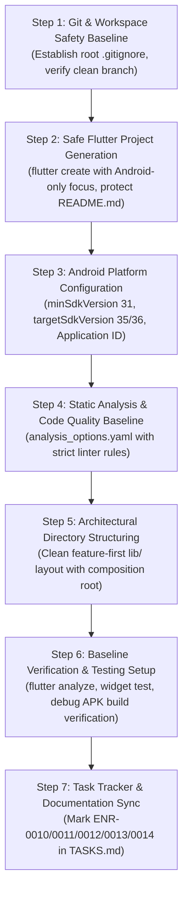

# EmotionalNovelReader (ENR)
## Stage A: Comprehensive Project Initialization and Technical Investigation Report

**Lead Flutter Architect, Senior Android Engineer, and Technical Lead**  
**Date:** November 9, 2026  
**Status:** Stage A Complete (Read-Only Investigation) — Awaiting User Approval for Stage B  
**Governing Documents:** `AGENT.md`, `PRD.md`, `TRD.md`, `ROADMAP.md`, `TASKS.md`, `DECISIONS.md`, `CHANGELOG.md`, `README.md`

---

## 1. Executive Summary

### 1.1 Current Project Condition
The EmotionalNovelReader (ENR) repository is in an early, clean pre-bootstrap state. The project has undergone a complete strategic pivot from an earlier legacy stack (React Native frontend and Node.js/Express backend) to a fresh, offline-first Flutter application targeting Android 12+ (API 31+). 

All legacy code and temporary test scripts were systematically purged in commit `27fadf9`. In subsequent commits (`ca08266`, `222a310`, `f00ee8f`), authoritative documentation, tracking files, agent skill definitions, and initial Android Studio metadata were established. At present, **no Flutter application files, no Dart sources, no `pubspec.yaml`, no Android Gradle build scripts, and no backend servers exist in the working tree.** The repository is cleanly tracked on Git branch `feature/flutter`.

### 1.2 Overall Initialization Readiness
- **Workspace & Git:** **READY.** Clean working tree on `feature/flutter`, matching remote `origin/feature/flutter`.
- **Flutter & Dart SDKs:** **READY.** Flutter 3.47.9 (channel stable), Dart 3.13.7 installed and functional.
- **Android SDK & Toolchain:** **READY.** Android SDK 36.0.0, Build-tools 36.0.0, Platforms 35/36/37 installed; all Android licenses accepted; Android Studio JBR (OpenJDK 25.0.4) and standalone Microsoft JDK 17 are available.
- **Device & Emulator:** **READY.** Android Emulator `Medium_Phone_API_37.0` is configured and available via `flutter emulators`.
- **Documentation:** **EXEMPLARY.** Complete alignment across PRD, TRD, ROADMAP, TASKS, DECISIONS, and AGENT.md.
- **Stage A Execution:** Strict read-only discipline has been maintained. Zero project files have been altered, added, or deleted.

### 1.3 Major Findings
1. **No Source Clutter or Half-Migrated Legacy Artifacts:** The working tree contains zero residual JavaScript, TypeScript, or Express code. The legacy implementation lives purely in Git history (`main` branch and commits prior to `27fadf9`).
2. **Missing Root `.gitignore`:** When the legacy codebase was purged in `27fadf9`, the root `.gitignore` was removed. Before generating or staging Flutter files, a robust Flutter/Dart/Android `.gitignore` must be established to prevent accidental commits of build artifacts or local keys.
3. **Sandbox Filesystem Boundary:** The Flutter SDK (`C:\Users\vansh\Documents\flutter\...`) and Android SDK (`C:\Users\vansh\AppData\Local\Android\Sdk`) reside outside the repository root workspace. Sandboxed terminal executions encounter `CommandNotFoundException` or `UnauthorizedAccessException` unless run with sandbox bypass or explicitly whitelisted.
4. **Android API Level Target vs Installed Platforms:** The PRD specifies Android 12+ (API 31+) as the minimum deployment target. Installed SDK platforms are API 35, 36, and 37.0. `minSdkVersion = 31` with `compileSdkVersion = 35` (or 36) is fully supported, but an API 31 or API 33 emulator/device should be provisioned for backward-compatibility regression testing.
5. **Decisions Register State:** Product constraints (ENR-DEC-001 through ENR-DEC-024) are accepted. Technical architecture selections (ENR-DEC-025 through ENR-DEC-056) are intentionally held as *Proposed* pending Phase 2 technical investigations.

### 1.4 Critical Blockers
- **Zero Critical Technical Blockers for Project Initialization (Phase 1).** The environment can generate and build a clean Flutter Android project immediately upon user approval.
- **Governance Gate:** Per Stage A instructions and `AGENT.md`, all implementation activities (Flutter project creation, dependency configuration, directory structuring) require explicit user sign-off.

---

## 2. Repository Audit

### 2.1 Workspace Path & Layout
- **Root Path:** `C:\Users\vansh\Documents\Projects\EmotionalNovelReader`
- **Subdirectories Present:**
  - `.git/` (Git version control database)
  - `.idea/` (Android Studio / IntelliJ project configuration; contains `deviceStreaming.xml`, `deviceManager.xml`, `misc.xml`, `modules.xml`, `vcs.xml`, and `.idea/.gitignore`)
  - `.agents/` (Comprehensive agent skill definitions)
- **Root Files Present:**
  - `AGENT.md` (Engineering governance and AI operating instructions; 813 lines)
  - `PRD.md` (Product Requirements Document; 1,339 lines)
  - `TRD.md` (Technical Requirements Document; 802 lines)
  - `ROADMAP.md` (Phased delivery roadmap; 1,188 lines)
  - `TASKS.md` (Canonical task tracker; 2,020 lines)
  - `DECISIONS.md` (ADR and constraint register; 1,526 lines)
  - `CHANGELOG.md` (Keep-a-Changelog specification; 860 lines)
  - `README.md` (Developer overview and architectural orientation; 912 lines)

### 2.2 Git Status & Branch Audit
- **Current Branch:** `feature/flutter`
- **Remote Tracking:** `origin/feature/flutter` (`https://github.com/Vansh4291/EmotionalNovelReader.git`)
- **Status:** `nothing to commit, working tree clean`
- **Commit History (Recent 5 commits):**
  - `f00ee8f` - *chore: add Android Studio project configuration files*
  - `222a310` - *feat: add comprehensive suite of agent skill definitions*
  - `ca08266` - *docs: initialize core project documentation and tracking files*
  - `27fadf9` - *Refactor code structure for improved readability and maintainability* (purged legacy frontend/backend)
  - `57a7123` - *feat: add LibraryScreen component for managing and importing books* (last legacy React Native commit)

### 2.3 Legacy Code & Remnants Check
- **React Native / Expo:** None in working tree. Confirmed removed.
- **Node.js / Express Backend:** None in working tree. Confirmed removed.
- **Scratch scripts & temporary test files:** None in working tree. Confirmed removed.
- **Multiple repositories:** No submodules or nested repositories found. Single unified Git repository.

### 2.4 Uncommitted Work & Potential Risks
- Working tree is 100% clean. No uncommitted user modifications exist.
- **Risk:** Generating a Flutter project in-place via `flutter create .` inside an existing directory with documentation requires care to avoid overwriting `README.md` or existing project markdown files.

---

## 3. Environment Audit

### 3.1 Installed Toolchain Versions & Diagnostics

| Tool | Version / Details | Status | Notes |
|---|---|---|---|
| **Flutter SDK** | 3.47.9 (Channel stable, rev `c197ca5199`, 2026-10-29) | **Healthy** | Installed at `C:\Users\vansh\Documents\flutter\flutter_windows_3.47.9-stable\flutter` |
| **Dart SDK** | 3.13.7 (DevTools 2.60.0) | **Healthy** | Bundled with Flutter SDK |
| **Android SDK** | Version 36.0.0 (Platforms: 35, 36, 37.0) | **Healthy** | Installed at `C:\Users\vansh\AppData\Local\Android\Sdk` |
| **Android Build-Tools** | 28.0.3, 34.0.0, 35.0.0, 36.0.0 | **Healthy** | Build tools 34.0.0+ fully satisfy Android 12+ requirements |
| **Android Platform-Tools** | ADB version 1.0.41 (v37.0.1) | **Healthy** | Located in `AppData\Local\Android\Sdk\platform-tools\adb.exe` |
| **Android Emulator** | Emulator version 37.2.13.0 | **Healthy** | AVD `Medium_Phone_API_37.0` configured and ready |
| **Java / JDK (Flutter)** | OpenJDK 25.0.4 (`Android Studio\jbr\bin\java`) | **Healthy** | Automatically identified and used by `flutter doctor` |
| **Java / JDK (System)** | OpenJDK 17.0.20.1 Microsoft LTS (`C:\Program Files\Microsoft\...`) | **Healthy** | In system PATH |
| **Gradle** | System binary not in PATH; will use Gradle Wrapper | **Healthy** | Flutter project generation provisions `gradlew` automatically |
| **Android Studio** | Version 262.10968.63 (Ladybug / Iguana+) | **Healthy** | Located at `C:\Program Files\Android\Android Studio` |
| **VS Code** | 1.144.0 (x64) | **Healthy** | Configured with Flutter extensions |
| **Git** | 2.55.0.windows.3 | **Healthy** | Full repository tracking active |
| **Node.js** | v24.19.0 | Available | Present on system; irrelevant to offline-first Flutter app |

### 3.2 Flutter Doctor Verbose Summary
```
[√] Flutter (Channel stable, 3.47.9, on Microsoft Windows [Version 10.0.26300.9711], locale en-IN)
[√] Windows Version (Windows 11 or higher, 26H2, 2009)
[√] Android toolchain - develop for Android devices (Android SDK version 36.0.0)
    • Platform android-37.0, build-tools 36.0.0
    • ANDROID_HOME = C:\Users\vansh\AppData\Local\Android\Sdk
    • Java binary at: C:\Program Files\Android\Android Studio\jbr\bin\java (build 25.0.4)
    • All Android licenses accepted.
[√] Chrome - develop for the web
[!] Visual Studio - develop Windows apps (Desktop development with C++ not installed)
    -> Irrelevant: Project target is Android first.
[√] Connected device (2 available: Windows desktop, Chrome web)
[√] Network resources: Available
```

---

## 4. Documentation Audit

### 4.1 Mandatory Documents Checklist
1. `AGENT.md`: **Present** (Root, 813 lines). Defines governance, boundary, git safety, reporting.
2. `PRD.md`: **Present** (Root, 1,339 lines). Canonical product authority.
3. `TRD.md`: **Present** (Root, 802 lines). Comprehensive technical requirements and open discovery matrix.
4. `ROADMAP.md`: **Present** (Root, 1,188 lines). 13-phase sequencing from baseline to production release.
5. `TASKS.md`: **Present** (Root, 2,020 lines). Master task register with canonical `ENR-XXXX` IDs.
6. `DECISIONS.md`: **Present** (Root, 1,526 lines). Constraints ENR-DEC-001–024 (Accepted); Architecture ENR-DEC-025–056 (Proposed).
7. `CHANGELOG.md`: **Present** (Root, 860 lines). Keep-a-Changelog format initialized.
8. `README.md`: **Present** (Root, 912 lines). Project and architectural baseline overview.
9. `docs/`: **Not present**. All documentation is currently consolidated at repository root.

### 4.2 Documentation Consistency Analysis
- **PRD vs TRD Alignment:** High fidelity. Both mandate offline-first core functionality, zero mandatory authentication, Android 12+ (API 31+) minimum, privacy-first AI with no silent cloud fallbacks, and user-owned data integrity.
- **Tasks & Roadmap Synchronization:**
  - `TASKS.md` Phase 1 defines tasks `ENR-0010` (Verify repository/workspace) and `ENR-0011` (Verify development environment). These correspond directly to Stage A and are completed by this investigation.
  - `ENR-0012` (Create fresh Flutter project), `ENR-0013` (Establish Git workflow), and `ENR-0014` (Establish baseline quality tooling) represent Stage B.
  - Minor Discrepancy: `ENR-0015` in `TASKS.md` states "Establish project tracking files: Create DECISIONS.md and CHANGELOG.md". However, `DECISIONS.md` and `CHANGELOG.md` were already authored and committed in `ca08266`. `ENR-0015` should simply be marked verified/synchronized rather than recreated.
- **TRD Proposed vs Accepted Technologies:** The TRD lists candidate packages (e.g., Drift, Riverpod, flutter_tts, onnxruntime). Crucially, `DECISIONS.md` correctly catalogs these as `Proposed` (ENR-DEC-025 through ENR-DEC-056). Neither the code nor the documentation treats candidate options as pre-approved.

---

## 5. Technical Readiness Assessment (32 Focus Areas)

The following matrix audits the 32 architectural domains identified across `TRD.md` and `DECISIONS.md`:

| Domain | Canonical ID | Status | Available Evidence / Investigation Findings | Decision Required Before Stage B? |
|---|---|---|---|---|
| **1. Flutter Architecture** | ENR-DEC-025 | Proposed | Feature-first layered architecture (Presentation, Application/Domain, Data) is proposed. Provides clean separation without over-engineering. | **No** (Foundational skeleton can start minimal; final module freezing in Phase 2) |
| **2. State Management** | ENR-DEC-026 | Proposed | Riverpod (`flutter_riverpod`) vs BLoC vs Provider evaluated in TRD. Riverpod offers compile-time safety and testability without code generation overhead. | **No** (Bootstrap requires only standard Flutter `runApp`; state library decided in Phase 2) |
| **3. Dependency Injection** | ENR-DEC-027 | Proposed | Riverpod providers vs `get_it`. Service locator vs constructor injection. | **No** (Can inject directly via composition root in Phase 1) |
| **4. Navigation & Routing** | ENR-DEC-028 | Proposed | `go_router` vs Navigator 2.0. Declarative routing required for reader deep-linking and state restoration. | **No** (Initial home screen uses default routing; `go_router` evaluated in Phase 2) |
| **5. Local Database** | ENR-DEC-029 | Proposed | Drift (SQLite) vs Isar vs ObjectBox. Drift provides typed SQL, full offline ACID compliance, schema migrations, and FTS5 search integration. | **No** (Phase 2 investigation; no DB needed for initial bootstrap) |
| **6. File Storage & SAF** | ENR-DEC-030 | Proposed | Android Scoped Storage / Storage Access Framework (SAF) required for Android 12+ persistent URI permissions (`takePersistableUriPermission`). | **No** (Phase 2 investigation) |
| **7. Reader Engines** | ENR-DEC-031 | Proposed | Unified `ReaderEngine` abstraction covering EPUB (HTML/DOM or native canvas), PDF (`pdfx` / PdfRenderer), TXT (virtualized sliver list). | **No** (Phase 2 investigation) |
| **8. Import Pipeline** | ENR-DEC-032 | Proposed | Two-phase import: file validation/hash computation, then background parsing and chapter extraction. | **No** (Phase 2 investigation) |
| **9. Full-Text Search** | ENR-DEC-033 | Proposed | SQLite FTS5 with unicode61 tokenizer. Tokenized book text table decoupled from raw book storage. | **No** (Phase 2 investigation) |
| **10. Local AI Inference** | ENR-DEC-034 | Proposed | ONNX Runtime Mobile vs TensorFlow Lite / MediaPipe vs llama.cpp bindings for quantized local SLMs. | **No** (Phase 2/8 investigation) |
| **11. AI Model Lifecycle** | ENR-DEC-035 | Proposed | Model manifest, SHA-256 verification, user-initiated download, background resume, storage quotas. | **No** (Phase 8 investigation) |
| **12. Cloud AI Provider** | ENR-DEC-036 | Proposed | Standardized OpenAI-compatible / Gemini REST client adapter; explicit opt-in only; no silent fallback. | **No** (Phase 10 investigation) |
| **13. RAG Architecture** | ENR-DEC-037 | Proposed | Semantic chunking with chapter/paragraph metadata, spoiler boundary filtering, SQLite vector / cosine similarity. | **No** (Phase 9 investigation) |
| **14. Spoiler Protection** | ENR-DEC-038 | Proposed | Hard predicate filter: `chunk_index <= current_reading_progress.chunk_index`. Enforced at query level. | **No** (Phase 9 investigation) |
| **15. TTS & Narration** | ENR-DEC-039 | Proposed | Android `TextToSpeech` engine via platform channels or `flutter_tts`, foreground media service, Android `MediaSession`. | **No** (Phase 7 investigation) |
| **16. Android Platform Integration** | ENR-DEC-040 | Proposed | Native Kotlin plugin channels for SAF URI persistence, foreground audio service, and exact alarms. | **No** (Phase 1/7 investigation) |
| **17. Background Execution** | ENR-DEC-041 | Proposed | Android `WorkManager` for import indexing and AI model processing; Android Foreground Service for audio. | **No** (Phase 2/7 investigation) |
| **18. Offline Data Consistency** | ENR-DEC-042 | Proposed | Single source of truth in local SQLite; atomic transactions for progress updates; write-ahead logging (WAL). | **No** (Phase 2 investigation) |
| **19. Backup & Restore** | ENR-DEC-043 | Proposed | Zip-based container with `manifest.json`, SQLite dump, and book files. SHA-256 integrity check. Unencrypted warning. | **No** (Phase 6 investigation) |
| **20. Database Migrations** | ENR-DEC-044 | Proposed | Sequential integer versioning with automated step-up/step-down test harness in Drift. | **No** (Phase 2 investigation) |
| **21. Security Architecture** | ENR-DEC-045 | Proposed | Threat model: path traversal defense during unzipping, encrypted key storage, zero logging of user content. | **No** (Established in PRD/TRD constraints) |
| **22. Networking Foundation** | ENR-DEC-046 | Proposed | `dio` or standard `http` with TLS 1.3 enforcement, circuit breaker, offline detection via `connectivity_plus`. | **No** (Phase 2 investigation) |
| **23. Diagnostics & Logging** | ENR-DEC-047 | Proposed | Local circular buffer log; sanitized export; opt-in crash report via Sentry or Firebase. | **No** (Phase 2 investigation) |
| **24. Testing & QA Strategy** | ENR-DEC-048 | Proposed | Unit tests for domain logic; Widget tests for UI components; Integration tests on Android emulator (`test_driver`). | **No** (Phase 1 sets up base test runner) |
| **25. Performance Budgets** | ENR-DEC-049 | Proposed | Cold start < 1500ms, frame budget 60fps (16.6ms), memory baseline < 150MB, import speed > 500KB/s. | **No** (Benchmarks run during Phase 2+) |
| **26. Accessibility** | ENR-DEC-050 | Proposed | Semantic widgets, TalkBack screen reader labels, dynamic text scaling (min 200%), minimum 48dp touch targets. | **No** (Continuous design constraint) |
| **27. Localization** | ENR-DEC-051 | Proposed | `flutter_localizations` with ARB files; English first; RTL and CJK text layout support. | **No** (Configured in Phase 1/2) |
| **28. CI/CD** | ENR-DEC-052 | Proposed | GitHub Actions workflow: `flutter analyze`, `flutter test`, `flutter build apk --debug`. | **No** (Phase 1/3 implementation) |
| **29. Credential Storage** | ENR-DEC-053 | Proposed | `flutter_secure_storage` using Android Keystore (AES-GCM-256) for optional cloud API keys. | **No** (Phase 10 implementation) |
| **30. Dependency Governance** | ENR-DEC-054 | Proposed | Strict dependency vetting: permissive licenses (MIT/BSD/Apache), active maintenance (<6 months), no telemetry. | **No** (Policy enforced starting Stage B) |
| **31. Resource Budgets** | ENR-DEC-055 | Proposed | Thermal throttling awareness, battery monitoring, RAM ceiling for AI inference (<400MB). | **No** (Phase 8 investigation) |
| **32. Release & Rollout** | ENR-DEC-056 | Proposed | Versioning `0.1.0-beta.1`, signed APK/AAB with Play Console / GitHub Releases distribution. | **No** (Phase 11 implementation) |

---

## 6. Risks and Blockers

### 6.1 Critical Risks (P0)
- **None Identified at Stage A.** The environment is fully capable of bootstrapping the Flutter project.

### 6.2 High Risks (P1)
- **Existing Documentation Preservation During `flutter create`:** Running `flutter create` in the root directory can overwrite `README.md` if not handled with precise options.
  - *Mitigation:* Back up `README.md` to memory or temporary safety buffer, run `flutter create --org com.emotionalnovelreader --project-name emotional_novel_reader --platforms android .`, and restore our authoritative `README.md`.
- **Root `.gitignore` Omission:** Without a root `.gitignore`, ephemeral Flutter build folders (`.dart_tool/`, `build/`, `android/.gradle/`) could pollute Git tracking.
  - *Mitigation:* Immediately establish standard Flutter + Android `.gitignore` upon project generation.

### 6.3 Medium Risks (P2)
- **Android Target vs Emulator API Discrepancy:** The minimum Android version is API 31 (Android 12), but the installed emulator is API 37.0.
  - *Mitigation:* Ensure `minSdkVersion = 31` and `targetSdkVersion = 35/36` in `android/app/build.gradle`. Create an API 31 or 33 AVD in Android Studio when conducting backward-compatibility testing.
- **Terminal Sandbox Execution with Bypass:** Flutter SDK tools reside in the user's home directory. Standard sandbox commands without elevation cannot invoke `flutter`. Commands running Flutter CLI must run with sandbox bypass or have directory access explicitly permitted.

### 6.4 Low Risks (P3)
- **Visual Studio Desktop Workload Missing:** Flagged as an exclamation mark in `flutter doctor`. Not an issue because Windows Desktop is explicitly out of scope for ENR.

---

## 7. Recommended Stage B Initialization Plan

Upon receiving user approval, the following sequential, dependency-ordered plan will be executed:



### Detailed Execution Steps

#### Step 1: Git and Workspace Safety Baseline
- **Action:** Create authoritative root `.gitignore` covering Dart, Flutter, Android, Gradle, and IDE user states.
- **Dependencies:** None.
- **Completion Criteria:** `git status` verifies `.gitignore` is present and untracked files are correctly ignored.

#### Step 2: Safe Flutter Project Creation
- **Action:** Run `flutter create --org com.emotionalnovelreader --project-name emotional_novel_reader --platforms android .`
- **Safeguard:** Preserve existing `README.md`, `AGENT.md`, `PRD.md`, `TRD.md`, `ROADMAP.md`, `TASKS.md`, `DECISIONS.md`, `CHANGELOG.md`.
- **Dependencies:** Step 1.
- **Completion Criteria:** Valid `pubspec.yaml`, `lib/main.dart`, and `android/` directory created without altering existing markdown documentation.

#### Step 3: Initial Android Platform Configuration
- **Action:**
  - Update `android/app/build.gradle` (or Kotlin DSL `build.gradle.kts`):
    - `minSdkVersion = 31` (Android 12)
    - `compileSdkVersion = 35` / `targetSdkVersion = 35`
    - `namespace = "com.emotionalnovelreader"`
    - `applicationId = "com.emotionalnovelreader"`
  - Verify Gradle wrapper and Android build tools compatibility.
- **Dependencies:** Step 2.
- **Completion Criteria:** Gradle configuration passes syntax validation and aligns with ENR-DEC-002.

#### Step 4: Code Quality and Static Analysis
- **Action:** Configure `analysis_options.yaml` with `flutter_lints` and strict typing rules (`implicit-casts: false`, `implicit-dynamic: false`).
- **Dependencies:** Step 2.
- **Completion Criteria:** `flutter analyze` runs cleanly with 0 issues.

#### Step 5: Clean Project Directory Structure
- **Action:** Establish initial feature-first architectural skeleton in `lib/`:
  ```
  lib/
  ├── app/                     # App-level config, themes, composition root
  │   ├── app.dart
  │   └── theme/
  ├── core/                    # Cross-cutting utilities, errors, constants
  │   ├── constants/
  │   ├── errors/
  │   └── utils/
  ├── features/                # Domain feature modules (placeholders)
  │   ├── library/
  │   ├── reader/
  │   ├── audio/
  │   ├── ai/
  │   └── settings/
  └── main.dart                # Application entrypoint
  ```
- **Dependencies:** Step 4.
- **Completion Criteria:** Clean directory layout adhering to `AGENT.md` Section 6 without circular dependencies.

#### Step 6: Initial Automated Testing & Android Build Verification
- **Action:**
  - Create smoke widget test in `test/widget_test.dart`.
  - Execute `flutter test`.
  - Execute `flutter build apk --debug`.
- **Dependencies:** Steps 3, 5.
- **Completion Criteria:** Tests pass 100%, debug APK builds successfully, confirming complete toolchain integrity.

#### Step 7: Documentation & Task Tracker Synchronization
- **Action:**
  - Update `TASKS.md` marking `ENR-0010` and `ENR-0011` as Complete, `ENR-0012` through `ENR-0014` as Complete upon verification.
  - Update `CHANGELOG.md` under `[Unreleased]` with project initialization entry.
  - Commit changes to `feature/flutter` with conventional commit message: `feat: initialize fresh Flutter project with Android 12+ baseline`.
- **Dependencies:** Step 6.
- **Completion Criteria:** Full traceability chain intact.

---

## 8. Governance and Approval Checklist

### 8.1 Actions Ready to Proceed Autonomously in Stage B (Post-Approval)
- Generate Flutter project scaffolding via `flutter create`.
- Establish root `.gitignore`.
- Set Android `minSdkVersion = 31` and compile targets in `build.gradle`.
- Configure `analysis_options.yaml`.
- Establish `lib/` directory structure and composition root.
- Run `flutter analyze`, `flutter test`, and `flutter build apk --debug`.
- Update `TASKS.md` and `CHANGELOG.md` to reflect verified setup state.

### 8.2 Actions Requiring Explicit Human Approval
- **Transition from Stage A to Stage B (Current Stop Gate).**
- Adoption of specific Phase 2 third-party dependencies (Riverpod vs BLoC, Drift vs ObjectBox, etc.).
- Modification or deletion of any legacy Git history or branch restructuring.
- Any cloud AI provider integration or external network telemetry.

### 8.3 Blockers That Must Be Resolved First
- **None.** All prerequisites for Stage B project bootstrap are met.

---

## 9. Conclusion & Stop-Gate Confirmation

Stage A read-only technical investigation is **100% complete**. No files have been created, modified, or removed in the repository. The environment is verified and in optimal condition to support a clean, robust Flutter initialization targeting Android 12+.

**I am paused at this gate awaiting your explicit approval to proceed with Stage B: Project Implementation.**
